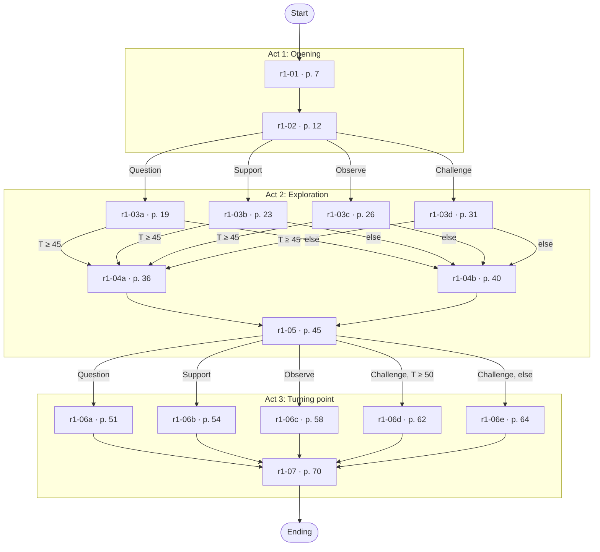
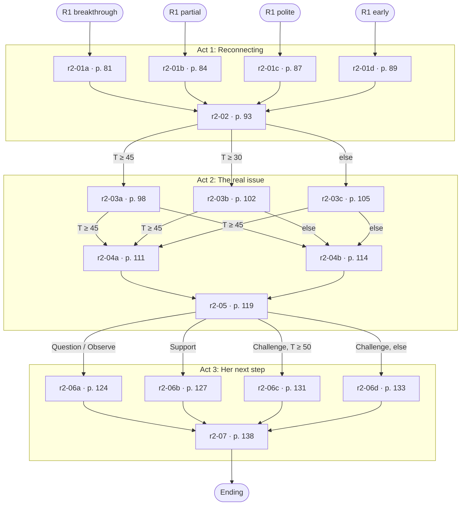

# Turn the Page — content review

*Generated by `tests/export-review.mjs` from `src/content/maya.js`, `src/engine.js` and `tests/calibrate.mjs`. Do not edit by hand.*

This document is for review by a developmental-coaching expert. It contains the whole script for both rounds, every number the engine uses, every hand-tuned override and the calibration report. Every scoring value is an initial value and every trait mapping is a design hypothesis (SPEC.md 1, 7); none is an empirical finding.

How to read the scripts: each page shows what Maya says, what the counsellor can see, and the options. For each option: the lever, the wording quality (Round 1 only), Maya's reaction, any override, the meter change it causes in two reference states, and the debrief note. The reference states have no previous choices; in play, repetition and the meters at that moment change the numbers. **Round 1 reference:** Maya's starting meters (Trust 35, Confidence 30, Ownership 15), and the same with Trust 55. **Round 2 reference:** the "after Polite exit" start (Trust 30, Confidence 30, Ownership 15, readiness low), and the same with Trust 55. T = Trust, C = Confidence, O = Ownership.

Contents: [Maya](#maya) · [Round 1](#round-1-just-lazy) · [Round 2](#round-2-two-weeks-later) · [Turning points](#turning-points-and-road-not-taken) · [Overrides](#every-override) · [Rules](#rules-table) · [Calibration](#calibration-report) · [Placeholders](#placeholder-strings)

## Maya

- **Name and age:** Maya, 16
- **Stage:** Two years before finishing secondary school; starting to think about university and career options
- Her grades have dropped this term across several subjects.
- She used to participate actively in class.
- Her family expects (unspoken in Round 1) that she will study medicine.
- **Traits (hidden in play):** confidence `low`, extraversion `mid`, defensiveness `mid`, readiness `low`. Readiness rises one band in Round 2 after a Breakthrough or Partial ending.
- **Starting meters:** trust 35, confidence 30, ownership 15

**Referral — Student Support** — Student: Maya, 16 · two years before finishing secondary school · Referred by: Mr Okafor, Maths teacher

> Maya's grades have dropped noticeably this term across several subjects. She used to participate actively but has gone quiet in class and has missed two homework deadlines. When I asked, she said she's "just being lazy." I don't think that's the full story. Could you have a conversation with her?

| Hint in the note | Trait | Debrief note |
|---|---|---|
| She used to participate actively but has gone quiet in class | extraversion | Extraversion: mid, currently suppressed. She is not a naturally quiet student; something has made her withdraw. Open questions yield more once trust is in place. |
| she said she's "just being lazy." | confidence | Self-confidence: low. She reaches for a harsh label for herself, so Support tends to be needed before a Challenge can land. |
| When I asked, she said | defensiveness | Defensiveness: mid. She answered a teacher's question with a ready-made explanation that closes the subject: protective, but not hostile. |
| has missed two homework deadlines | readiness | Readiness for change: low. The pattern is established and she has not yet tried to change it, so Ownership builds slowly in the first act. |

## Round 1: Just lazy

Format B: the counsellor picks a lever, then one of three wordings (skilful, plausible or clumsy, unlabelled, shuffled). 15 pages.

| Act | Title | Cliffhanger (act banner) |
|---|---|---|
| 1 | Opening | She looked at the door. Then she looked back at you. |
| 2 | Exploration | Everyone had decided. Nobody had asked her. |
| 3 | Turning point | The bell was about to ring. Whatever happened next would be hers, or nobody's. |

### Node map



### Script

#### r1-01 · p. 7 · Act 1

**Maya:** "Mr Okafor sent me. I know — my grades. I'm just being lazy."

**Cue:** She sits on the edge of the chair nearest the door, bag strap still in her hand. She said it before you asked anything. *(pose: gaze door, arms bag, chair edge, shoulders raised)*

**Next:** r1-02

| Lever | Counsellor says | Maya's reaction | Override | Δ at start (T 35) | Δ at T 55 | Debrief note |
|---|---|---|---|---|---|---|
| Question (skilful) | Thanks for coming. Before we get to grades, how has this term been for you? | She shrugs. "Fine. Busy. I don't know." But she sits back a little.<br>*[extraversion:high]* "Honestly? Weird." She starts to say more, then stops herself.<br>*(pose: chair back)* | T +1, O +2 | T +4, C +1, O +6 | T +4, C +1, O +6 | An open start that put her experience before the grades. It gave her room, though at this point she had little to fill it with. |
| Question (plausible) | Thanks for coming. What do you think has made the grades slip this term? | "I don't know. I just stopped keeping up." She keeps hold of the strap.<br>*(pose: arms bag)* | — | T +1, C +1, O +4 | T +1, C +1, O +4 | A reasonable question about causes, asked before she had settled. She answered it, inside the frame of the grades she came in braced for. |
| Question (clumsy) | Thanks for coming. Is it mainly the homework, or are lessons harder too? | "Both, I guess." She looks at the floor.<br>*(pose: gaze floor)* | — | T −1, C ±0, O +2 | T −1, C ±0, O +2 | An either-or question that set the options for her. It was easy to answer, and it narrowed the talk to schoolwork before she had said what was going on. |
| Support (skilful) | Thanks for coming in. You're not in trouble. I'd just like to hear how things are from your side. | "OK." Her shoulders come down a little. She looks at you properly for the first time.<br>*[defensiveness:high]* "That's what everyone says." But she stays in the chair.<br>*(pose: shoulders relaxed, gaze counsellor)* | T +4 | T +11, C +8, O ±0 | T +11, C +8, O ±0 | Lowered the stakes before anything else. Trust rose quickly; she had not yet done any of the thinking. |
| Support (plausible) | Thanks for coming in. Lots of students have a term like this, and it usually settles down. | "Maybe." She nods, but her hand stays on the strap.<br>*(pose: arms bag)* | — | T +4, C +5, O ±0 | T +4, C +5, O ±0 | Normalising, and kindly meant. It reassured her before she had said anything, so it reassured a version of the problem you had guessed. |
| Support (clumsy) | Thanks for coming in. I don't think you're lazy at all, from what Mr Okafor has told me. | "He doesn't know either." A half-smile, as if you have missed the point.<br>*(pose: mouth slightSmile)* | — | T +1, C +3, O ±0 | T +1, C +3, O ±0 | Warm, and it contradicted her account before you had heard it. It also told her she had been discussed, which made the reassurance harder to trust. |
| Observe (skilful) | You said that very quickly, before I'd asked anything. It sounds like you've had that conversation a few times already. | She blinks. "I mean... yeah. Everyone keeps saying it." She lets go of the bag strap.<br>*[defensiveness:high]* "So?" She grips the strap tighter, but she is listening.<br>*(pose: arms lap)* | T +5, O +3 | T +3, C +2, O +6 | T +7, C +2, O +6 | Named something real in what she said, without judging it. At low trust an observation can feel exposing; this one was gentle enough to open a door. |
| Observe (plausible) | You're sitting near the door with your bag still in your hand. It looks as if you're not sure how long this will take. | "I've got class after." She sits back a little anyway.<br>*(pose: chair back)* | — | T −3, C +1, O +3 | T ±0, C +1, O +3 | Accurate: you described what you could see. At this level of trust a comment on her body can feel like being watched, and she explained it away. |
| Observe (clumsy) | You said "lazy" very quickly, before I'd asked anything. It sounds like you've already decided that's the answer. | "Well, it is the answer." She grips the strap.<br>*(pose: arms bag)* | — | T −4, C +1, O +2 | T −1, C +1, O +2 | Started from what she said and ended on a judgement about her. "Already decided" sounded like criticism, and she held her position. |
| Challenge (skilful) | "Lazy" is one explanation. I'm not sure it's the whole one. | She frowns. "What else would it be?" Her arms fold.<br>*[confidence:high]* She tilts her head. "Go on, then. What else?"<br>*(pose: arms crossed, mouth tight)* | O +2 | T −8, C −5, O +4 | T −6, C +2, O +6 | A thoughtful reframe, offered before there was trust to hold it. It planted a seed and cost some rapport. |
| Challenge (plausible) | "Lazy" is one explanation. Usually there's something else behind it. | "Like what?" She sounds tired rather than curious. | — | T −9, C −5, O +1 | T −8, C +1, O +6 | A fair point, made as a general rule. It suggested you knew her story before she had told it. |
| Challenge (clumsy) | "Lazy" is one explanation. It doesn't sound like the real one to me. | She folds her arms. "Well, it is." The room goes quiet.<br>*(pose: arms crossed, mouth tight)* | T −2 | T −13, C −5, O +1 | T −11, C +1, O +4 | Set your view against hers before there was trust to hold it. Her explanation became something to defend. |

#### r1-02 · p. 12 · Act 1

**Maya:** "So what is this, then? Like, a warning?"

**Cue:** The bag is off her shoulder now, but it is on her lap, both hands on it. *(pose: gaze counsellor, arms bag, chair edge)*

**Next:** question → r1-03a; support → r1-03b; observe → r1-03c; challenge → r1-03d; default → r1-03a

| Lever | Counsellor says | Maya's reaction | Override | Δ at start (T 35) | Δ at T 55 | Debrief note |
|---|---|---|---|---|---|---|
| Question (skilful) | What would you want to get out of talking today, if anything? | "I don't know. Not being nagged, I guess." She thinks. "Maybe working out why I can't just... do stuff." | T +1, O +5 | T +4, C +1, O +6 | T +4, C +1, O +6 | Asked her to set the purpose of the conversation. It handed her some ownership early, though she had to think on the spot. |
| Question (plausible) | What do you think Mr Okafor is hoping we'll get out of today? | "For me to stop being lazy, probably." She shrugs. | — | T +1, C +1, O +4 | T +1, C +1, O +4 | Invited her view, but of someone else's purpose. She answered for Mr Okafor, and the conversation stayed his. |
| Question (clumsy) | Shall we use today to make a plan for getting the grades back up? | "I guess." She says it as if she has said it many times before. | — | T −1, C ±0, O +2 | T −1, C ±0, O +2 | A closed question with your agenda inside it. She agreed; the purpose was yours, not hers. |
| Support (skilful) | It's not a warning. It's just a chance to talk about how things are going, at whatever pace suits you. | "OK." She puts the bag down on the floor.<br>*(pose: arms lap)* | T +5 | T +12, C +8, O ±0 | T +12, C +8, O ±0 | Removed the threat and let her set the pace. Trust rose; the purpose of the conversation stayed vague. |
| Support (plausible) | It's not a warning. Lots of students come in here, and it usually turns out to be nothing serious. | "OK." Her hands stay on the bag.<br>*(pose: arms bag)* | — | T +4, C +5, O ±0 | T +4, C +5, O ±0 | Lowered the stakes by making it ordinary. It reassured her, and it also told her the answer before she had said anything. |
| Support (clumsy) | It's not a warning. We'll work out what's going wrong and get you back on track in no time. | "Right." She does not look convinced.<br>*(pose: mouth flat)* | O −2 | T +1, C +3, O −2 | T +1, C +3, O −2 | Rescuing: it promised an outcome and took the problem onto your shoulders. Kind, and it assumed there was a problem to fix before she had said what it was. |
| Observe (skilful) | You asked if it's a warning. It sounds like you're expecting to be in trouble. | "Aren't I?" A pause. "Everyone's been on at me."<br>*[extraversion:low]* She nods, once, and says nothing. | T +3, O +3 | T +1, C +2, O +6 | T +5, C +2, O +6 | Reflected her own words back. It showed you were listening and let her name what she was afraid of. |
| Observe (plausible) | You're holding on to your bag with both hands. It looks like you're ready to leave. | "I'm fine." She loosens her grip a little.<br>*(pose: arms bag)* | — | T −3, C +1, O +3 | T ±0, C +1, O +3 | An accurate description of what you could see. It pointed at her wish to leave rather than at what she had asked, so she brushed it off. |
| Observe (clumsy) | You asked if it's a warning. It sounds like you think you deserve one. | "I didn't say that." Her hands tighten on the bag.<br>*(pose: arms bag, mouth tight)* | — | T −4, C +1, O +2 | T −1, C +1, O +2 | Began by reflecting her words, then added a meaning she had not given them. It was easy to argue with, and she did. |
| Challenge (skilful) | I don't think Mr Okafor sees this as a warning. He told me he doesn't think "lazy" is the full story. | She looks up. "He said that?" She does not seem to know what to do with it.<br>*(pose: head up, gaze counsellor)* | T +1, O +2 | T −7, C −5, O +4 | T −5, C +2, O +6 | Offered a different view of why she was here. It questioned her story about being in trouble; how it landed depended on the trust built so far. |
| Challenge (plausible) | I don't think Mr Okafor sees this as a warning. He's worried about you and wants to help you catch up. | "Catch up. Right." She looks down at the bag.<br>*(pose: gaze floor)* | — | T −9, C −5, O +1 | T −8, C +1, O +6 | Offered a kinder view of why she was here, then brought it back to catching up. It eased the fear and kept the grades at the centre. |
| Challenge (clumsy) | I don't think Mr Okafor sees this as a warning yet. But two missed deadlines is a pattern he can't ignore. | "So it is a warning." She looks at the door.<br>*(pose: gaze door)* | T −2 | T −13, C −5, O +1 | T −11, C +1, O +4 | Started as reassurance and ended as a verdict. The facts were accurate; "yet" confirmed the fear she came in with. |

#### r1-03a · p. 19 · Act 2

**Maya:** "I don't know. I stay up really late. Then I'm too tired to start anything, so I don't."

**Cue:** She picks at the strap of her bag while she talks. *(pose: gaze floor, arms lap)*

**Next:** r1-04a if trust ≥ 45; r1-04b otherwise

| Lever | Counsellor says | Maya's reaction | Override | Δ at start (T 35) | Δ at T 55 | Debrief note |
|---|---|---|---|---|---|---|
| Question (skilful) | What's happening in those late evenings? | "Nothing. Phone. Videos. Just... not thinking." She stops. "That sounds bad."<br>*[extraversion:high]* "Oh, everything. Videos, messages, then it's one o'clock." She laughs, then doesn't. | T +2, O +4 | T +5, C +1, O +10 | T +5, C +1, O +10 | Followed her own words into the detail. She explored, and noticed something about herself. |
| Question (plausible) | What time do you usually get to sleep? | "One? Two, sometimes." She shrugs. "It's not that late." | — | T +1, C +1, O +4 | T +1, C +1, O +4 | A practical question that went straight to the sleep, which is where an adult would look first. She gave you the number and not much else. |
| Question (clumsy) | Have you tried going to bed a bit earlier? | "Yeah. It doesn't work." She stops picking at the strap. | — | T −1, C ±0, O +2 | T −1, C ±0, O +2 | Advice in the shape of a question. It assumed the answer was the bedtime, and she had already tried that. |
| Support (skilful) | That sounds exhausting. Tired, and then annoyed with yourself for being tired. | "Yeah. Exactly that." She sighs.<br>*(pose: shoulders relaxed)* | T +3 | T +10, C +5, O ±0 | T +10, C +5, O ±0 | Named the feeling accurately. She felt understood; the conversation stayed with the feeling rather than moving on. |
| Support (plausible) | That sounds exhausting. No wonder starting anything in the evening feels so hard. | "Yeah." She nods. "So it's the sleep, I suppose." | — | T +4, C +4, O ±0 | T +4, C +4, O ±0 | Validating, and it accepted her explanation whole. She felt understood and settled on tiredness as the full story. |
| Support (clumsy) | That sounds exhausting. Try not to worry about it too much, it'll sort itself out. | "OK." She seems to have nothing to add. | — | T +1, C +2, O ±0 | T +1, C +2, O ±0 | Comforting, and it closed the subject. If it will sort itself out, there is nothing left for her to think about. |
| Observe (skilful) | You said "so I don't". You didn't say "I can't". | She thinks about it. "I suppose. It's easier not to start than to start and be rubbish at it." | T +1, O +2 | T −1, C +2, O +6 | T +3, C +2, O +6 | Fed back a detail of her own words. It let her notice a choice inside the habit, and she did the thinking. |
| Observe (plausible) | You started with the late nights, not the work. | "Because that's what it is." She shrugs. | — | T −3, C +1, O +3 | T ±0, C +1, O +3 | Noticed the order she told it in, which was accurate. It pointed at the sleep story she had already chosen, so it confirmed it. |
| Observe (clumsy) | You said "so I don't". It sounds like you choose not to. | "I don't choose it." She pulls her sleeves down over her hands.<br>*(pose: arms lap, head down)* | — | T −4, C +1, O +2 | T −1, C +1, O +2 | Took her exact words and turned them into a verdict about her will. She defended herself instead of thinking about it. |
| Challenge (skilful) | Being that tired is real. I wonder if "lazy" is the right word for someone who's this tired. | "What else would you call it?" But she is thinking about it. | O +3 | T −8, C −5, O +5 | T −6, C +2, O +12 | Questioned her label with care. It offered a new frame; whether she could take it depended on the trust built so far. |
| Challenge (plausible) | Being that tired is real. It sounds more like a sleep problem than a laziness problem. | "Maybe." She considers it, without much interest. | — | T −9, C −5, O +1 | T −8, C +1, O +6 | Replaced her label with a kinder one of yours. It eased the self-criticism, and the new explanation was still not hers. |
| Challenge (clumsy) | Being that tired is real, but staying up is a choice you are making every night. | "I know." Flat. She looks away.<br>*(pose: gaze window)* | — | T −11, C −5, O +1 | T −9, C +1, O +4 | Accurate, and it put the whole problem down to her choices. She agreed, and the agreement closed the subject. |

#### r1-03b · p. 23 · Act 2

**Maya:** "It's not like I don't try. I sit down to do it, and then... I just don't start."

**Cue:** Her shoulders have come down. She is looking at the desk now, not the door. *(pose: gaze floor, arms lap, shoulders neutral)*

**Next:** r1-04a if trust ≥ 45; r1-04b otherwise

| Lever | Counsellor says | Maya's reaction | Override | Δ at start (T 35) | Δ at T 55 | Debrief note |
|---|---|---|---|---|---|---|
| Question (skilful) | What happens in the moment you sit down? | "I look at it and it's like... too much. So I do something else." | T +2, O +4 | T +5, C +1, O +10 | T +5, C +1, O +10 | Slowed down on the exact moment things stall for her. She described it in her own words, which is where ownership starts. |
| Question (plausible) | What is it you're meant to be working on? | "Chemistry, mostly. English." She lists it flatly. | — | T +1, C +1, O +4 | T +1, C +1, O +4 | A useful practical question. It moved to the content of the work and away from what happens to her when she sits down. |
| Question (clumsy) | Is it that the work feels too hard? | "No. I mean, some of it. I don't know." | — | T −1, C ±0, O +2 | T −1, C ±0, O +2 | Offered her a ready-made reason. It was easy to half-agree with, and it guessed rather than asked. |
| Support (skilful) | That's a horrible feeling, wanting to start and not being able to. | "Yeah." Quietly. "It is."<br>*(pose: head down)* | T +3 | T +10, C +5, O ±0 | T +10, C +5, O ±0 | Acknowledged the feeling without hurrying her. Trust grew; nothing new came out yet. |
| Support (plausible) | That happens to a lot of people. Starting is often the hardest part. | "I guess." She looks back at the desk.<br>*(pose: gaze floor)* | — | T +4, C +4, O ±0 | T +4, C +4, O ±0 | Normalising, and true. It told her she was not alone, and it made her experience general just as she was describing her own. |
| Support (clumsy) | Don't be so hard on yourself. You'll get there when you're ready. | "Maybe." She does not sound convinced. | — | T +1, C +2, O ±0 | T +1, C +2, O ±0 | Kind, and it skipped past the feeling to a promise. She had just said she could not start; being told she would did not help her see why. |
| Observe (skilful) | You said "it's not like I don't try". It sounds like trying matters to you. | "Well, yeah. I'm not just sitting there doing nothing." She sits up a little.<br>*(pose: head up)* | T +1, O +2 | T −1, C +2, O +6 | T +3, C +2, O +6 | Reflected back what she valued in her own words. It gave her a better story about herself, and she took it. |
| Observe (plausible) | You said you sit down to do it. So you are getting as far as the desk. | "I suppose." A small shrug. | — | T −3, C +1, O +3 | T ±0, C +1, O +3 | Picked out something she was doing, which is encouraging. It sounded a little like a consolation prize, and she did not take it further. |
| Observe (clumsy) | You said "it's not like I don't try". It sounds like you want me to believe that. | "Because it's true." Sharper than she meant.<br>*(pose: mouth tight)* | — | T −4, C +1, O +2 | T −1, C +1, O +2 | Reflected her words with a hint of doubt attached. She heard the doubt and defended herself. |
| Challenge (skilful) | You keep sitting down to do it. That doesn't sound like someone who's lazy. | She looks at you. "I suppose not." She does not sound sure.<br>*(pose: gaze counsellor)* | O +4 | T −8, C −5, O +6 | T −6, C +2, O +13 | Pushed back on her label using her own evidence. A strong reframe; it asked her to see herself differently, which takes trust. |
| Challenge (plausible) | You keep sitting down to do it. Maybe the trick is a smaller first step. | "Maybe." She does not seem to know what that would be. | — | T −9, C −5, O +1 | T −8, C +1, O +6 | Moved straight to a solution. The idea is sensible; it arrived before she understood the problem, so it was your idea to try. |
| Challenge (clumsy) | You keep sitting down to do it, but sitting there isn't the same as doing it. | "I know that." She folds her arms.<br>*(pose: arms crossed)* | — | T −11, C −5, O +1 | T −9, C +1, O +4 | A fair point, made as a reprimand. It told her something she already knew and left her defending herself. |

#### r1-03c · p. 26 · Act 2

**Maya:** "I'm not expecting trouble. I'm just tired of everyone asking what's wrong."

**Cue:** The bag is on the floor now. Her arms are loosely crossed. *(pose: gaze counsellor, arms crossed, shoulders neutral)*

**Next:** r1-04a if trust ≥ 45; r1-04b otherwise

| Lever | Counsellor says | Maya's reaction | Override | Δ at start (T 35) | Δ at T 55 | Debrief note |
|---|---|---|---|---|---|---|
| Question (skilful) | What would you want people to understand, instead of asking? | "That I don't know what's wrong. That's the whole thing." | T +1, O +4 | T +4, C +1, O +10 | T +4, C +1, O +10 | Turned her complaint into something she could say for herself. She answered honestly, and the not-knowing became the subject. |
| Question (plausible) | What do you usually say when people ask you what's wrong? | "That I'm fine. That I'm tired." She shrugs. "Same as now." | — | T +1, C +1, O +4 | T +1, C +1, O +4 | Asked about the pattern she was tired of, which is a reasonable thread. It also had her rehearse the answer she gives everyone. |
| Question (clumsy) | So when they ask, is there something you'd rather not say? | "No. That's what I mean." She sighs. | — | T −1, C ±0, O +2 | T −1, C ±0, O +2 | Asked the very question she had just said she was tired of, in a gentler form. She gave the same answer she gives everyone. |
| Support (skilful) | That sounds tiring. I'll try not to be one more person asking the same thing. | A small laugh. "Thanks."<br>*(pose: mouth slightSmile)* | T +3 | T +10, C +5, O ±0 | T +10, C +5, O ±0 | Took her side on the thing she found hard, with a light touch. Trust rose; the exploring waited. |
| Support (plausible) | That sounds tiring. People only ask because they care about you, you know. | "I know." She says it to the floor.<br>*(pose: gaze floor)* | — | T +4, C +4, O ±0 | T +4, C +4, O ±0 | Defended the people asking, which is fair to them. It asked her to see their side before you had seen hers. |
| Support (clumsy) | That sounds tiring. Nothing is wrong with you, so you don't need to explain. | "My grades say there is." | — | T +1, C +2, O ±0 | T +1, C +2, O ±0 | Reassurance that contradicted the reason she was here. It was kind, and she argued with it. |
| Observe (skilful) | You said "everyone". It sounds like it's coming from a lot of directions at once. | "Teachers. Home. Everyone." She stops there. | T +1, O +4 | T −1, C +2, O +8 | T +3, C +2, O +8 | Picked out one word and reflected its weight. She told you more than she meant to, without being asked directly. |
| Observe (plausible) | You put your bag down a minute ago. You seem a bit more settled than when you came in. | "I suppose." She glances at the bag, then back at you. | — | T −3, C +1, O +3 | T ±0, C +1, O +3 | Accurate and warm. It moved attention to how she was sitting just as she had said something about other people. |
| Observe (clumsy) | You said "everyone". It sounds like you feel everyone is against you at the moment. | "I didn't say against me." Her arms tighten.<br>*(pose: arms crossed)* | — | T −4, C +1, O +2 | T −1, C +1, O +2 | Went one step beyond her word and made it bigger. She pushed back on the exaggeration and did not add anything. |
| Challenge (skilful) | I don't think Mr Okafor asked what was wrong to nag you. He noticed you'd gone quiet, and that's not like you. | "He noticed?" Surprised, then wary.<br>*(pose: gaze counsellor)* | O +3 | T −8, C −5, O +5 | T −6, C +2, O +12 | Offered a different reading of the attention she resented. It could reframe the nagging as care, if she trusted you enough to hear it. |
| Challenge (plausible) | I don't think people ask to nag you. Most of them can see you're having a hard time this term. | "Maybe." She does not sound convinced. | — | T −9, C −5, O +1 | T −8, C +1, O +6 | Offered a kinder reading of the people asking. It was general, so it was easy for her to set aside. |
| Challenge (clumsy) | I don't think people ask to nag you. Your grades have dropped, so it's a fair thing for them to ask. | "I didn't say it wasn't fair." She looks away.<br>*(pose: gaze window)* | — | T −11, C −5, O +1 | T −9, C +1, O +4 | A reasonable point, and it took the others' side. She felt told off rather than heard. |

#### r1-03d · p. 31 · Act 2

**Maya:** "Whatever. I'm just not bothered any more. It's pointless anyway."

**Cue:** Her arms are folded. She is looking at the clock above the door. *(pose: gaze door, arms crossed, shoulders raised, mouth tight)*

**Next:** r1-04a if trust ≥ 45; r1-04b otherwise

| Lever | Counsellor says | Maya's reaction | Override | Δ at start (T 35) | Δ at T 55 | Debrief note |
|---|---|---|---|---|---|---|
| Question (skilful) | What's made it feel pointless? | A long pause. "I don't know. It just does." | T +2, O +2 | T +5, C +1, O +8 | T +5, C +1, O +8 | Stayed curious after a push had landed badly. It kept the door open, although she was not ready to walk through it. |
| Question (plausible) | What would make it feel worth it? | "Dunno. Nothing, probably." Her arms stay folded.<br>*(pose: arms crossed)* | — | T +1, C +1, O +4 | T +1, C +1, O +4 | A forward-looking question, asked before she had said why it felt pointless. It was too far ahead of her to answer. |
| Question (clumsy) | Don't you care about your grades? | "Of course I care." Too fast. | — | T −1, C ±0, O +2 | T −1, C ±0, O +2 | A closed question with a judgement folded into it. She gave the answer it invited, quickly. |
| Support (skilful) | I pushed a bit fast just then. Sorry. We can slow down. | She glances at you, surprised. Her arms loosen slightly.<br>*(pose: gaze counsellor, arms lap)* | T +5 | T +12, C +5, O ±0 | T +12, C +5, O ±0 | Repaired the moment by owning your part in it. Trust recovered; the conversation itself had not moved on yet. |
| Support (plausible) | That's OK. Lots of people feel like that at some point in school. | "Yeah, well." She keeps looking at the clock. | — | T +4, C +4, O ±0 | T +4, C +4, O ±0 | Normalising, which lowers the stakes. It also accepted "pointless" as the end of the matter. |
| Support (clumsy) | It's not pointless. You've got a lot of potential, you know. | "Everyone says that." She sounds tired. | — | T +1, C +2, O ±0 | T +1, C +2, O ±0 | Encouragement that argued with her. She has heard it before, and it told her you had not heard her. |
| Observe (skilful) | You said "any more". So there was a time when you were bothered. | "...Yeah. Last year I actually liked school." She looks surprised that she said it.<br>*(pose: gaze counsellor, head up)* | T +1, O +2 | T −1, C +2, O +6 | T +3, C +2, O +6 | Caught a small word that carried a lot. It let her remember a different version of herself without being told to. |
| Observe (plausible) | You keep looking at the clock. It seems like you want this to be over. | "Kind of." She looks at you, then back at the clock. | — | T −3, C +1, O +3 | T ±0, C +1, O +3 | Accurate, and honest about what you saw. It named her wish to leave, which she could only agree with. |
| Observe (clumsy) | You've folded your arms. It looks like you've decided not to talk to me. | "I'm sitting here, aren't I?" She does not move. | — | T −4, C +1, O +2 | T −1, C +1, O +2 | Read her posture as a decision about you. It made the moment about the relationship, and she held her ground. |
| Challenge (skilful) | Pointless is a strong word. You still came in today, when you could have not. | "I had to come." But she does not get up. | O +3 | T −8, C −5, O +5 | T −6, C +2, O +12 | Offered evidence against her own word. It was a fair push; with trust this low it was always going to cost something. |
| Challenge (plausible) | Pointless is a strong word. It can't be completely pointless if you're still here. | "I had to come." She shrugs. | — | T −9, C −5, O +1 | T −8, C +1, O +6 | A gentle argument with her word. Logic is easy to answer with a fact, and she had one ready. |
| Challenge (clumsy) | Pointless is a strong word. It sounds more like a reason not to bother trying. | "Can you not." She looks at the door.<br>*(pose: gaze door)* | — | T −11, C −5, O +1 | T −9, C +1, O +4 | Challenged her word by questioning her motive. It landed as an accusation before there was trust to hold it. |

#### r1-04a · p. 36 · Act 2

**Maya:** "Like last week. I had a chemistry thing due. I opened it, looked at it, and then I was on my phone for two hours. Every night it's the same."

**Cue:** When she mentions next year's exams, she takes out her phone and turns it over and over in her hand. *(pose: gaze phone, arms lap, props phone)*

**Next:** r1-05

| Lever | Counsellor says | Maya's reaction | Override | Δ at start (T 35) | Δ at T 55 | Debrief note |
|---|---|---|---|---|---|---|
| Question (skilful) | What goes through your head when you open it? | "That it's going to be rubbish anyway. So why bother." | T +1, O +4 | T +4, C +1, O +10 | T +4, C +1, O +10 | Went underneath the habit to the thought driving it. She named it herself, which is harder to forget than being told. |
| Question (plausible) | What were you doing on your phone for those two hours? | "Scrolling. Nothing, really." She turns the phone over.<br>*(pose: gaze phone)* | — | T +1, C +1, O +4 | T +1, C +1, O +4 | Followed the most visible detail. It kept the conversation on the phone rather than on what she was avoiding. |
| Question (clumsy) | So is the phone the main problem, do you think? | "I guess." She puts it away, as if caught.<br>*(pose: props none)* | — | T −1, C ±0, O +2 | T −1, C ±0, O +2 | A leading question with the answer in it. She agreed, and put the phone out of sight, which hid the cue. |
| Support (skilful) | Two hours of avoiding something you're dreading. That's a hard way to spend an evening. | "It's awful, actually. I feel worse after." | T +3 | T +10, C +5, O ±0 | T +10, C +5, O ±0 | Recognised how unpleasant the avoiding is. She admitted it out loud; the cue in her hands went unremarked. |
| Support (plausible) | Two hours goes quickly on a phone. It happens to everyone, adults included. | "I suppose." She turns the phone over again. | — | T +4, C +4, O ±0 | T +4, C +4, O ±0 | Normalised it, which took away some shame. It also made it sound like a phone habit rather than avoidance. |
| Support (clumsy) | Two hours is a lot, but everyone puts things off. Try not to worry about it. | "Yeah, but not every night." | — | T +1, C +2, O ±0 | T +1, C +2, O ±0 | Reassured her by making it small. She put you right: for her it was every night. |
| Observe (skilful) | I noticed you picked up your phone as soon as you mentioned next year. | She looks at it in her hand, then puts it face down on her knee. "I didn't even notice."<br>*[extraversion:low]* She stops turning the phone. A long silence. Then a very small nod.<br>*(pose: props none, head down)* | T +4, O +5 | T +2, C +2, O +9 | T +6, C +2, O +9 | Used a real, specific cue and did not turn it into a criticism. It showed her a pattern she had not seen for herself. |
| Observe (plausible) | I noticed you said it's the same every night. That sounds like a routine now. | "Pretty much." She keeps turning the phone. | — | T −3, C +1, O +3 | T ±0, C +1, O +3 | An accurate reflection of the pattern. It stayed with the evenings and missed the moment the phone came out. |
| Observe (clumsy) | I noticed you picked up your phone while we were talking. Is this boring you? | "No. Sorry." She pushes it into her pocket. Her face closes a little.<br>*(pose: props none)* | T −2 | T −6, C +1, O +2 | T −3, C +1, O +2 | Saw the right thing and read it as rudeness. She apologised and put the phone away, and with it the thing worth noticing. |
| Challenge (skilful) | You're calling that lazy. It sounds more like you're avoiding something. | She goes still. "Avoiding what?" She does not wait for an answer.<br>*(pose: shoulders raised)* | O +4 | T −8, C −5, O +6 | T −6, C +2, O +13 | Offered a different explanation for the same behaviour. It went close to the real issue; how close she let it come depended on trust. |
| Challenge (plausible) | You're calling that lazy. It sounds more like the phone is the problem. | "Maybe." She looks at the phone as if it might agree.<br>*(pose: gaze phone)* | — | T −9, C −5, O +1 | T −8, C +1, O +6 | Swapped her label for a more obvious one. It was easier to accept than "lazy", and it pointed away from what the phone was helping her avoid. |
| Challenge (clumsy) | You're calling that lazy. Two hours a night is where the grades have gone. | "Wow. OK." She puts the phone away and looks at the door.<br>*(pose: gaze door, props none)* | — | T −11, C −5, O +1 | T −9, C +1, O +4 | Connected the facts accurately and turned them into a verdict. She heard blame rather than a different view. |

#### r1-04b · p. 40 · Act 2

**Maya:** "Dunno. Can't be bothered, I guess."

**Cue:** She has her phone out. Each time you mention exams or next year, she looks down at the screen. *(pose: gaze phone, arms crossed, shoulders raised, props phone)*

**Next:** r1-05

| Lever | Counsellor says | Maya's reaction | Override | Δ at start (T 35) | Δ at T 55 | Debrief note |
|---|---|---|---|---|---|---|
| Question (skilful) | What's it like when you try to think about next year? | She shrugs, eyes on the screen. "I don't really."<br>*(pose: gaze phone)* | T +1, O +4 | T +4, C +1, O +10 | T +4, C +1, O +10 | An open question aimed at the right place. With trust this low she could only give a small answer, but it was hers. |
| Question (plausible) | What subjects are you thinking of taking next year? | "Haven't decided." She keeps her eyes on the screen.<br>*(pose: gaze phone)* | — | T +1, C +1, O +4 | T +1, C +1, O +4 | A practical question about next year. It asked for decisions while the cue was that next year itself was hard to look at. |
| Question (clumsy) | Are you worried about the exams next year, is that it? | "Not really." She scrolls.<br>*(pose: gaze phone)* | — | T −1, C ±0, O +2 | T −1, C ±0, O +2 | Named a feeling for her and asked her to confirm it. A closed question is easy to deflect, and she did. |
| Support (skilful) | It's OK if this is hard to talk about. We don't have to rush. | She looks up from the phone. "OK."<br>*(pose: gaze counsellor)* | T +5 | T +12, C +5, O ±0 | T +12, C +5, O ±0 | Took the pressure off when she was shutting down. Trust recovered; the topic was put on hold. |
| Support (plausible) | It's OK. Most people your age can't be bothered with exams yet. | "Yeah." She keeps scrolling.<br>*(pose: gaze phone)* | — | T +4, C +4, O ±0 | T +4, C +4, O ±0 | Met her where she was, and agreed with "can't be bothered". It kept her comfortable and the subject closed. |
| Support (clumsy) | It's OK. The exams are ages away, so there's nothing to worry about. | "Right." She keeps scrolling.<br>*(pose: gaze phone)* | — | T +1, C +2, O ±0 | T +1, C +2, O ±0 | Tried to remove the worry by moving it further away. It did not match what her phone was telling you. |
| Observe (skilful) | Every time next year comes up, you look at your phone. I'm not telling you off. I noticed it, that's all. | She stops scrolling. A pause. "It's easier than thinking about it."<br>*[extraversion:low]* She stops scrolling. She does not look up, but she puts the phone away.<br>*(pose: arms lap)* | T +4, O +5 | T +2, C +2, O +9 | T +6, C +2, O +9 | Named the pattern and removed the threat in the same breath. When she was saying least, what she was doing said most. |
| Observe (plausible) | You've had your phone out most of the time. I'm not telling you off. I wondered if you'd noticed. | "Sorry." She puts it face down, but her eyes stay on it.<br>*(pose: gaze phone)* | — | T −3, C +1, O +3 | T ±0, C +1, O +3 | Named the phone without blame. It noticed the habit and missed the pattern of when she reached for it. |
| Observe (clumsy) | Every time next year comes up, you look at your phone. It's hard to talk to you while you're on it. | "I'm listening." She does not look up.<br>*(pose: gaze phone)* | T −3 | T −7, C +1, O +2 | T −4, C +1, O +2 | Saw the pattern and used it as a complaint. It made the phone a matter of manners rather than something to understand. |
| Challenge (skilful) | I don't think you can't be bothered. I think something about next year is getting to you. | She looks up, then away. "Maybe."<br>*(pose: gaze window)* | O +3 | T −8, C −5, O +5 | T −6, C +2, O +12 | Offered a different explanation for "can't be bothered". It was close to the truth, and pushing at low trust carries a cost. |
| Challenge (plausible) | I don't think you can't be bothered. I think you're more tired than you're letting on. | "Maybe." She shrugs, still scrolling. | — | T −9, C −5, O +1 | T −8, C +1, O +6 | Pushed back on "can't be bothered", which was a fair push. The alternative you offered was a guess, and not the one the cue pointed to. |
| Challenge (clumsy) | I don't think you can't be bothered. I think you're scared of failing the exams. | "I'm not scared." She half stands up, then sits back down.<br>*(pose: chair edge)* | — | T −11, C −5, O +1 | T −9, C +1, O +4 | Named a fear for her, confidently. Even if it was close, being told what she feels made her defend herself. |

#### r1-05 · p. 45 · Act 2

**Maya:** "Anyway. Everyone's already decided what I'm doing after school."

**Cue:** She says it quietly, to the window. She does not explain, and she does not look at you. *(pose: gaze window, head down, mouth flat)*

**Next:** question → r1-06a; support → r1-06b; observe → r1-06c; challenge → r1-06d if trust ≥ 50; r1-06e otherwise; default → r1-06a

| Lever | Counsellor says | Maya's reaction | Override | Δ at start (T 35) | Δ at T 55 | Debrief note |
|---|---|---|---|---|---|---|
| Question (skilful) | What's it like, having that already decided? | "It's fine. It's just... how it is." Her voice is smaller.<br>*(pose: head down)* | T +1, O +5 | T +4, C +1, O +11 | T +4, C +1, O +11 | Asked about her experience of the decision rather than the decision itself. She did not explain, but she stayed with it. |
| Question (plausible) | What has everyone decided you'll be doing? | "It's... a plan. It's fine." She keeps looking at the window.<br>*(pose: gaze window)* | — | T +1, C +1, O +4 | T +1, C +1, O +4 | The natural next question. It asked for something she had not offered, and kept the attention on what others had decided rather than on her. |
| Question (clumsy) | Who's decided that? Is it your family? | "I didn't say that." She closes the subject. | — | T −1, C ±0, O +2 | T −1, C ±0, O +2 | Put an answer inside the question and named her family before she had. She shut the topic rather than choose to explain. |
| Support (skilful) | That sounds like a lot to carry on your own. | She nods, only just. | T +3 | T +10, C +5, O ±0 | T +10, C +5, O ±0 | Acknowledged the weight without prying. It kept her safe; what she meant stayed unsaid. |
| Support (plausible) | That's a lot. Plenty of people your age feel that. | "I suppose." She keeps looking at the window.<br>*(pose: gaze window)* | — | T +4, C +4, O ±0 | T +4, C +4, O ±0 | Kind, and it filed her experience under something common before you knew what it was. |
| Support (clumsy) | There's still plenty of time to work that out. | "Is there?" She looks at the floor.<br>*(pose: gaze floor)* | O −2 | T +1, C +2, O −2 | T +1, C +2, O −2 | Tried to lift the weight by giving her more time. Two years from finishing school, it did not match how close it felt to her. |
| Observe (skilful) | You said "everyone's decided". I noticed you didn't say what you'd decided. | She is quiet for a long moment. "No. I didn't." | T +1, O +5 | T −1, C +2, O +9 | T +3, C +2, O +9 | Reflected exactly what she had and had not said. It showed her where she was missing from her own sentence. |
| Observe (plausible) | You said that to the window. It seems hard to say it while looking at me. | "It's easier." She glances at you, then back at the window.<br>*(pose: gaze window)* | — | T −3, C +1, O +3 | T ±0, C +1, O +3 | Noticed something real about how she said it. Commenting on her discomfort drew attention to her rather than to what she had said. |
| Observe (clumsy) | You said "everyone's decided". It sounds like you don't agree with them. | "I didn't say that." Her mouth tightens.<br>*(pose: mouth tight)* | — | T −4, C +1, O +2 | T −1, C +1, O +2 | Went one step beyond her words and gave her a position she had not taken. She disowned it rather than explore it. |
| Challenge (skilful) | Maybe. But you'd be the one living it, so I'd be interested in what you think too. | "What I think doesn't really change anything." But she is looking at you now.<br>*(pose: gaze counsellor)* | O +4 | T −8, C −5, O +6 | T −6, C +2, O +13 | Put her own view back on the table without criticising anyone else's. A real push; it needed enough trust to be heard as interest, not as taking sides. |
| Challenge (plausible) | Maybe. But you'd be the one living it. Is it what you'd choose yourself? | "I don't know. Maybe." She shrugs, still facing the window.<br>*(pose: gaze window)* | — | T −9, C −5, O +1 | T −8, C +1, O +6 | A real push, asked as a yes-or-no question before she had said what the decision was. She could only answer it vaguely. |
| Challenge (clumsy) | Maybe. But you're the one living it, so they need to hear what you think. | "You don't know them." She looks away.<br>*(pose: gaze window)* | T −2 | T −13, C −5, O +1 | T −11, C +1, O +4 | Pushed her towards a conversation at home and cast her family as the obstacle. It took a side she had not taken. |

#### r1-06a · p. 51 · Act 3

**Maya:** "I don't know. I just want it to stop feeling like this."

**Cue:** She looks at you for the first time in a while. *(pose: gaze counsellor, arms lap)*

**Next:** r1-07

| Lever | Counsellor says | Maya's reaction | Override | Δ at start (T 35) | Δ at T 55 | Debrief note |
|---|---|---|---|---|---|---|
| Question (skilful) | If things were a bit better two weeks from now, what would be different? | She thinks. "I'd have started something. Even one thing. Without it being a whole drama." | T +2, O +5 | T +5, C +1, O +11 | T +5, C +1, O +11 | Asked her to picture a small, near future. She described a change in her own words, which made it hers. |
| Question (plausible) | What do you think is the main thing making it feel like this? | "I don't know. Everything?" She looks away again.<br>*(pose: gaze window)* | — | T +1, C +1, O +4 | T +1, C +1, O +4 | A fair question about causes. She had just turned towards wanting a change, and it turned her back to the problem. |
| Question (clumsy) | Do you want to feel better about school by the time we next meet? | "Well, yes." | — | T −1, C ±0, O +2 | T −1, C ±0, O +2 | A closed question with only one possible answer. It got a yes and no picture of what better would be. |
| Support (skilful) | That makes sense. Feeling stuck every evening sounds draining. | "It is." She breathes out.<br>*(pose: shoulders relaxed)* | T +3 | T +10, C +5, O ±0 | T +10, C +5, O ±0 | Stayed with the feeling she had just named. She felt heard; the future stayed unexplored. |
| Support (plausible) | That makes sense. It will stop, though. Things like this usually pass. | "I hope so." She does not sound sure. | — | T +4, C +4, O ±0 | T +4, C +4, O ±0 | Hopeful, and it arrived before she had said what "this" was. It promised an end without anything for her to do. |
| Support (clumsy) | That makes sense. Let's work out together how to make it stop, then. | "OK." She waits for you to start. | — | T +1, C +2, O ±0 | T +1, C +2, O ±0 | Generous and practical, and it took the lead from her. "Together" quickly became you doing the working out. |
| Observe (skilful) | When you said that, you sat up a little. It sounds like you want things to change. | "I do. I just don't know how." | T +1, O +2 | T −1, C +2, O +6 | T +3, C +2, O +6 | Linked what you saw to what she said. It let her hear her own wish for change. |
| Observe (plausible) | When you said that, you looked at me. It's the first time you've done that today. | "Is it?" She looks away again.<br>*(pose: gaze window)* | — | T −3, C +1, O +3 | T ±0, C +1, O +3 | Accurate, and it made her aware of being watched. She stepped back from the moment you had noticed. |
| Observe (clumsy) | When you said that, you sat up a little. It sounds like you know what to do about it. | "Do I?" She slumps back in the chair.<br>*(pose: chair back)* | — | T −4, C +1, O +2 | T −1, C +1, O +2 | Read her wish for change as knowing the answer. It put pressure on her to have one. |
| Challenge (skilful) | I think you have more say over how this feels than it seems right now. | "Like what?" Doubtful, but curious. | O +3 | T −8, C −5, O +5 | T −6, C +2, O +12 | Challenged her sense of helplessness. A hopeful push; it needed trust to sound like belief rather than blame. |
| Challenge (plausible) | I think it'll start to feel better once the homework is under control. | "Maybe." She does not sound convinced. | — | T −9, C −5, O +1 | T −8, C +1, O +6 | A sensible view from the outside. It made the homework the answer before she had said what would help. |
| Challenge (clumsy) | I think it won't stop by itself, though. Something will have to change. | "I know that." Flat. | — | T −11, C −5, O +1 | T −9, C +1, O +4 | True, and said as a warning. It told her what she already knew and gave her nothing to work with. |

#### r1-06b · p. 54 · Act 3

**Maya:** "Yeah. It is a lot. I don't really talk about it."

**Cue:** Her shoulders drop. She does not seem in a hurry to leave. *(pose: gaze floor, arms lap, shoulders relaxed)*

**Next:** r1-07

| Lever | Counsellor says | Maya's reaction | Override | Δ at start (T 35) | Δ at T 55 | Debrief note |
|---|---|---|---|---|---|---|
| Question (skilful) | If the next two weeks went a bit better, what would you notice first? | "That I'd done some homework without it being a whole thing." A small shrug. | T +2, O +5 | T +5, C +1, O +11 | T +5, C +1, O +11 | Moved from comfort to the future at the moment she felt safest. She did the picturing herself. |
| Question (plausible) | Who would you feel able to talk to about it, outside school? | "I don't know. No one, really." She shrugs. | — | T +1, C +1, O +4 | T +1, C +1, O +4 | A caring question that looked for support beyond this room. It moved away from the conversation she had just started having with you. |
| Question (clumsy) | Would it help to talk about it more often, maybe here with me? | "Maybe." | — | T −1, C ±0, O +2 | T −1, C ±0, O +2 | A kind offer as a closed question. She said maybe; it did not ask what she wanted. |
| Support (skilful) | I'm glad you're talking about it now. | "Me too. I think." | T +2, O −1 | T +9, C +5, O −1 | T +9, C +5, O −1 | Warm and true. More comfort at this point kept her safe, and it kept the next step with you. |
| Support (plausible) | I'm glad. Talking always helps. | "I guess." She smiles a little. | — | T +4, C +4, O ±0 | T +4, C +4, O ±0 | Warm, and a general rule. It praised the talking and moved past what she had said. |
| Support (clumsy) | You can come to me. I'll sort it out. | "OK." She looks relieved, and a little let off. | — | T +1, C +2, O ±0 | T +1, C +2, O ±0 | Generous, and it took the problem off her. Relief is not the same as a step of her own. |
| Observe (skilful) | You said you don't really talk about it. You're talking about it now. | "Yeah. Weird." A small smile.<br>*(pose: mouth slightSmile)* | T +1, O +2 | T −1, C +2, O +6 | T +3, C +2, O +6 | Showed her something she was already doing differently. Small, and it was hers. |
| Observe (plausible) | You said you don't really talk about it. That must make it feel heavier. | "I suppose." She shrugs. | — | T −3, C +1, O +3 | T ±0, C +1, O +3 | An empathic guess about how it felt. It was probably close, and it told her the feeling rather than letting her name it. |
| Observe (clumsy) | You said it's a lot. You look as if it's all getting on top of you. | "I'm fine." She sits up straighter, as if to prove it.<br>*(pose: chair back)* | — | T −4, C +1, O +2 | T −1, C +1, O +2 | Described her state rather than what you saw or heard. She had just admitted something, and the label made her take it back. |
| Challenge (skilful) | Not talking about it is one way to cope. I'm not sure it's working for you. | "...No. It isn't." | O +3 | T −8, C −5, O +5 | T −6, C +2, O +12 | Questioned her way of coping, gently. A push that relied on the warmth already there. |
| Challenge (plausible) | Not talking about it is one way to cope. It might help to tell someone at home. | "Maybe." She does not look keen. | — | T −9, C −5, O +1 | T −8, C +1, O +6 | A reasonable suggestion, made early. It pointed her towards home before you knew what home meant in this. |
| Challenge (clumsy) | Not talking about it is one way to cope, but you'll need to start talking at some point. | "I guess." | — | T −11, C −5, O +1 | T −9, C +1, O +4 | A fair point as an instruction. She agreed, and the instruction was yours. |

#### r1-06c · p. 58 · Act 3

**Maya:** "...I didn't say what I want, did I."

**Cue:** A short laugh that is not really a laugh. *(pose: gaze counsellor, mouth tight)*

**Next:** r1-07

| Lever | Counsellor says | Maya's reaction | Override | Δ at start (T 35) | Δ at T 55 | Debrief note |
|---|---|---|---|---|---|---|
| Question (skilful) | What would you want the next two weeks to look like? | "Less of this. Less being annoyed at myself at eleven at night." She pauses. "Actually starting things." | T +2, O +5 | T +5, C +1, O +11 | T +5, C +1, O +11 | Gave her the question she had just asked herself. She answered it, which made the future hers. |
| Question (plausible) | What do you think you might want to do after school? | "I don't know." She looks at the window. "Something."<br>*(pose: gaze window)* | — | T +1, C +1, O +4 | T +1, C +1, O +4 | The big question, asked at the first opening. It was too large a step from "I didn't say what I want". |
| Question (clumsy) | Do you know what you want, deep down, or not yet? | "No." Quickly. | — | T −1, C ±0, O +2 | T −1, C ±0, O +2 | A closed question that made her choose between knowing and not knowing. "No" was the quick way out. |
| Support (skilful) | That's OK. It's not easy to know what you want at sixteen. | "Everyone else seems to know." | T +3 | T +10, C +5, O ±0 | T +10, C +5, O ±0 | Normalised not knowing, kindly. It eased the pressure, and it eased the question away too. |
| Support (plausible) | That's OK. You don't need to know yet. There's plenty of time. | "OK." She lets it go. | — | T +4, C +4, O ±0 | T +4, C +4, O ±0 | Took the pressure off, which she may have needed. It also closed the door she had just opened. |
| Support (clumsy) | That's OK. We can work out what you want together, step by step. | "OK." She lets you take it. | — | T +1, C +2, O ±0 | T +1, C +2, O ±0 | A generous offer of help. "Together" put you in charge of finding out what she wanted. |
| Observe (skilful) | You laughed, but it didn't sound like you found it funny. | "No. It isn't." She looks at you properly.<br>*(pose: gaze counsellor)* | O +3 | T −2, C +2, O +7 | T +2, C +2, O +7 | Noticed the gap between her laugh and her face. It let her drop the act without being told to. |
| Observe (plausible) | You said that quietly, as if you'd noticed it for the first time. | "Kind of." She looks at her hands.<br>*(pose: gaze floor)* | — | T −3, C +1, O +3 | T ±0, C +1, O +3 | A gentle, accurate observation. It stayed with how she said it rather than with what she had realised. |
| Observe (clumsy) | You laughed, but it sounds like you don't know what you want. | "Thanks." The laugh is gone. | — | T −4, C +1, O +2 | T −1, C +1, O +2 | Started with what you saw and ended with a conclusion about her. The conclusion stung. |
| Challenge (skilful) | I think you might have more of an idea than you're letting yourself say. | She looks at you for a long moment. "Maybe."<br>*(pose: gaze counsellor)* | O +4 | T −8, C −5, O +6 | T −6, C +2, O +13 | Pushed on her not-knowing. With trust in place it can feel like belief in her; without it, like pressure. |
| Challenge (plausible) | I think you might want something different from what everyone has decided. | "Maybe." She does not say what. | — | T −9, C −5, O +1 | T −8, C +1, O +6 | A perceptive guess, said for her. It may have been close; she could agree without owning it. |
| Challenge (clumsy) | I think you need to work out what you want, then, before someone else does. | "Yeah. I know." | — | T −11, C −5, O +1 | T −9, C +1, O +4 | Pushed for urgency and hinted at others deciding for her. It took a side and added pressure. |

#### r1-06d · p. 62 · Act 3

**Maya:** "I suppose. I just don't know what I'd change."

**Cue:** She sits back and thinks. She has not looked at the door for a while. *(pose: gaze window, chair back)*

**Next:** r1-07

| Lever | Counsellor says | Maya's reaction | Override | Δ at start (T 35) | Δ at T 55 | Debrief note |
|---|---|---|---|---|---|---|
| Question (skilful) | If it were two weeks from now and things were slightly better, what would you see? | "Me doing chemistry before my phone. Maybe." She seems surprised by her own answer. | T +2, O +5 | T +5, C +1, O +11 | T +5, C +1, O +11 | Followed a push with an open question. The push opened the door; the question let her walk through it. |
| Question (plausible) | What do you think would make the biggest difference to your grades right now? | "Doing the homework, I guess." It sounds like the expected answer. | — | T +1, C +1, O +4 | T +1, C +1, O +4 | Asked for her view, on the grades and on the biggest change. She gave the answer she knew was expected. |
| Question (clumsy) | Would getting your homework in on time be a good change to start with? | "I guess." | — | T −1, C ±0, O +2 | T −1, C ±0, O +2 | Your change, phrased as a question. A yes was easy and did not commit her to anything. |
| Support (skilful) | Not knowing yet is fine. You've thought about a lot today. | "Yeah. My head hurts a bit." A smile.<br>*(pose: mouth smile)* | T +2 | T +9, C +5, O ±0 | T +9, C +5, O ±0 | Recognised the effort she had made. Trust rose; the change she might make stayed undefined. |
| Support (plausible) | Not knowing yet is fine. We can always come back to it next time. | "OK." She seems a little relieved. | — | T +4, C +4, O ±0 | T +4, C +4, O ±0 | Gave her room, which was kind. It let her off just as she had started thinking. |
| Support (clumsy) | Not knowing yet is fine. I'll help you work out what to change. | "OK." She waits for you to tell her. | — | T +1, C +2, O ±0 | T +1, C +2, O ±0 | Offered help, and in doing so took over the thinking. She waited for your answer. |
| Observe (skilful) | You've stopped looking at the door. You seem to be thinking about this. | "I am, actually." | T +1, O +2 | T −1, C +2, O +6 | T +3, C +2, O +6 | Showed her the change in her own behaviour. It affirmed her engagement without telling her what to think. |
| Observe (plausible) | You've sat back in the chair. You seem more relaxed than when you came in. | "I suppose." She glances at the door, then back.<br>*(pose: gaze door)* | — | T −3, C +1, O +3 | T ±0, C +1, O +3 | Accurate and warm. It noticed the comfort and missed the thinking, and drew her eye back to the door. |
| Observe (clumsy) | You've stopped looking at the door. You seem to know what needs to change. | "I don't, though." | — | T −4, C +1, O +2 | T −1, C +1, O +2 | Read her thinking as knowing. It put her on the spot to have an answer. |
| Challenge (skilful) | I think you already have one idea. You don't trust it yet, that's all. | "...Maybe the phone thing." She pulls a face.<br>*(pose: mouth tight)* | O +5 | T −8, C −5, O +7 | T −6, C +2, O +14 | A second push, made with trust already in place. It worked because it pointed at her idea, not yours. |
| Challenge (plausible) | I think the phone might be the place to start. It came up a few times. | "Maybe." She pulls a face. | — | T −9, C −5, O +1 | T −8, C +1, O +6 | A sensible starting point, offered by you. She could accept it without it being hers. |
| Challenge (clumsy) | I think you have to change something, or nothing will change, will it? | "Yeah, I get it." | — | T −11, C −5, O +1 | T −9, C +1, O +4 | True, and said as pressure. It asked her to agree rather than to think. |

#### r1-06e · p. 64 · Act 3

**Maya:** "You don't get it."

**Cue:** She pulls her bag back onto her lap. *(pose: gaze door, arms bag, chair edge, shoulders raised)*

**Next:** r1-07

| Lever | Counsellor says | Maya's reaction | Override | Δ at start (T 35) | Δ at T 55 | Debrief note |
|---|---|---|---|---|---|---|
| Question (skilful) | You're right, I might not. What am I missing? | A pause. "It's not about being lazy. It's just... a lot." | T +3, O +4 | T +6, C +1, O +10 | T +6, C +1, O +10 | Accepted her criticism and turned it into curiosity. It recovered some ground and let her put you right. |
| Question (plausible) | You're right, I might not. Is it after school? | "Partly." She keeps the bag on her lap.<br>*(pose: arms bag)* | — | T +1, C +1, O +4 | T +1, C +1, O +4 | Owned the gap and then filled it with a guess. She confirmed part of it and kept the rest. |
| Question (clumsy) | You're right. Can you help me get it, then? | "Not really." Her hands stay on the bag.<br>*(pose: arms bag)* | — | T −1, C ±0, O +2 | T −1, C ±0, O +2 | Agreed, then put the work of explaining back on her. At that moment, the "then" sounded like a test. |
| Support (skilful) | That's fair. I pushed. I'd still like to understand, if you'll let me. | She hesitates, then puts the bag down.<br>*(pose: arms lap)* | T +5 | T +12, C +5, O ±0 | T +12, C +5, O ±0 | Repaired the rupture openly. Trust came back; there was less time left to use it. |
| Support (plausible) | That's fair. Sorry. I was only trying to help you, that's all. | "I know." She keeps the bag on her lap.<br>*(pose: arms bag)* | — | T +4, C +4, O ±0 | T +4, C +4, O ±0 | Apologised, which helped, and then explained yourself. It made the repair about your intentions. |
| Support (clumsy) | That's fair. But I do get it more than you think. I was sixteen once. | "Not like this." | — | T +1, C +2, O ±0 | T +1, C +2, O ±0 | Tried to close the gap by sharing your own past. She heard that you knew better. |
| Observe (skilful) | You've picked up your bag. I think I pushed too hard a moment ago. | "A bit." The bag stays on her lap, but she does not stand.<br>*(pose: arms bag, chair edge)* | T +1, O +2 | T −1, C +2, O +6 | T +3, C +2, O +6 | Read the bag accurately and said so without blame. Naming the rupture helped repair it. |
| Observe (plausible) | You've picked up your bag. Do you want to stop for today? | "No. I don't know." She does not stand.<br>*(pose: arms bag)* | — | T −3, C +1, O +3 | T ±0, C +1, O +3 | Respected her signal and offered her the door. It was considerate, and it left the repair to her. |
| Observe (clumsy) | You've picked up your bag. You seem quite worked up about this. | "I'm not worked up." Her voice is louder.<br>*(pose: arms bag)* | — | T −4, C +1, O +2 | T −1, C +1, O +2 | Saw the bag and labelled her feeling. A label is easy to deny, and she did. |
| Challenge (skilful) | Maybe I don't. But I don't think you've given up, either. | "How would you know?" But she stays. | O +3 | T −8, C −5, O +5 | T −6, C +2, O +12 | Held your ground and expressed belief in her. A second push while she was upset; a risk, and she stayed. |
| Challenge (plausible) | Maybe I don't. But it would help if you told me, then. | "Maybe." She does not start. | — | T −9, C −5, O +1 | T −8, C +1, O +6 | A logical push. It was reasonable, and it asked her to do the repair. |
| Challenge (clumsy) | Maybe I don't. But I think you don't want to hear it, either. | She stands up. Then, slowly, she sits down again.<br>*(pose: chair edge)* | — | T −11, C −5, O +1 | T −9, C +1, O +4 | Matched her push with one of your own. It turned the moment into a stand-off. |

#### r1-07 · p. 70 · Act 3

**Maya:** "So what am I supposed to do, then?"

**Cue:** She glances at the clock. The bell will ring soon. *(pose: gaze counsellor)*

**Next:** end of round

| Lever | Counsellor says | Maya's reaction | Override | Δ at start (T 35) | Δ at T 55 | Debrief note |
|---|---|---|---|---|---|---|
| Question (skilful) | What's one small thing you'd want to try before we meet again? | She thinks for a while. "Maybe... do the chemistry first. Before my phone. Just to see."<br>*(pose: gaze window)* | T +1, O +5 | T +4, C +1, O +11 | T +4, C +1, O +11 | Asked her for the next step and waited. Whatever she chose, it was hers to try. |
| Question (plausible) | What do you think would help most with the homework deadlines? | "Start earlier, I guess." It sounds like something she has been told. | — | T +1, C +1, O +4 | T +1, C +1, O +4 | Invited her answer, on the deadlines that brought her here. She gave the answer she knew was expected. |
| Question (clumsy) | Could you try handing in the next piece of homework on time? | "I can try." She says it to the clock. | O −2 | T −1, C ±0, O ±0 | T −1, C ±0, O ±0 | Your step, phrased as a question. A yes was easy to give and easy to forget. |
| Support (skilful) | You don't have to fix everything this week. We can meet again in two weeks and see how things are. | "OK. Yeah." She seems lighter.<br>*(pose: shoulders relaxed)* | T +2, O −1 | T +9, C +5, O −1 | T +9, C +5, O −1 | Took the pressure off and kept the relationship going. She left lighter, without a step of her own. |
| Support (plausible) | You don't have to fix everything this week. Even one finished piece of homework would be a good start. | "OK. I'll try." She nods, a bit too quickly. | — | T +4, C +4, O ±0 | T +4, C +4, O ±0 | Encouraging, and it chose the step for her. She agreed to a reasonable target that was yours. |
| Support (clumsy) | You don't have to fix everything this week. I'll have a word with your teachers about the deadlines. | "Oh. OK. Thanks." She relaxes. The problem is yours now.<br>*(pose: chair back, shoulders relaxed)* | O −4 | T +1, C +2, O −4 | T +1, C +2, O −4 | Generous, and it took the problem off her. It also promised something that depended on other staff. |
| Observe (skilful) | You've talked about the moment you sit down and then stop. That moment seems to matter. | "Yeah. If I could just get past the first bit..." She trails off, thinking.<br>*(pose: gaze window)* | O +3 | T −2, C +2, O +7 | T +2, C +2, O +7 | Gave her back a thread from her own words and left the conclusion to her. She started to build on it. |
| Observe (plausible) | You've talked about your phone a few times. That seems to be where the evening goes. | "Yeah. I could leave it downstairs, I guess." She does not sound sure. | — | T −3, C +1, O +3 | T ±0, C +1, O +3 | An accurate thread from her own words, picked because it pointed at an obvious fix. She took the fix you had pointed to. |
| Observe (clumsy) | You've talked about the work in a lot of detail. It sounds like you already know what to do. | "Not really. That's why I'm here." | — | T −4, C +1, O +2 | T −1, C +1, O +2 | Assumed she had an answer she did not have. It left her with the pressure and none of the help. |
| Challenge (skilful) | I could give you a plan, but it would be my plan. I'd rather hear yours, even if it's small. | She looks surprised. Then: "OK. Let me think."<br>*(pose: head up)* | O +5 | T −8, C −5, O +7 | T −6, C +2, O +14 | Refused to take the problem off her, kindly. It is a push; with enough trust it hands her the pen. |
| Challenge (plausible) | I could give you a plan, but plans from me don't usually stick. Shall we make one together? | "OK. If you want." She waits for you to start. | — | T −9, C −5, O +1 | T −8, C +1, O +6 | Offered partnership, which sounds generous. As a yes-or-no question it left you holding the pen. |
| Challenge (clumsy) | I could give you a plan, but you'd need to stick to it this time. Are you up for that? | "This time?" She picks up her bag.<br>*(pose: arms bag, chair edge, gaze door)* | — | T −11, C −5, O +1 | T −9, C +1, O +4 | "This time" carried a judgement about last time. The push landed on her past rather than her next step. |

### Endings

| Ending | Title | Text | Debrief summary |
|---|---|---|---|
| breakthrough | Breakthrough | Maya proposes her own next step: one small thing she will try before you meet again. She says it slowly, as if checking that it belongs to her. At the door she turns round. "Same time in two weeks?" | Maya proposed a next step of her own, and asked to come back. |
| partial | Agreement without ownership | Maya agrees to the step you suggest. "OK. I'll try." She means it, mostly. But it is your plan, not hers, and you can both feel it. | Maya agreed to the step you suggested. The plan stayed yours. |
| polite | Polite exit | "Thanks for this." Maya picks up her bag and leaves on time. She was polite from start to finish. Nothing much has changed. | Maya stayed polite from start to finish and left unmoved. *If ownership ended high:* She did a lot of her own thinking: ownership ended high. Trust stayed below the level where she would commit to a step out loud, so the ideas left the room with her. |
| early | Early exit | "Can I go now?" Maya is already standing, bag on her shoulder. The conversation is over before it really began. | Trust ran out, and Maya left before the conversation really began. |

## Round 2: Two weeks later

Format C: four unlabelled, shuffled lines, one per lever, all competent; then the counsellor names the lever. 16 pages.

Opening page by Round 1 ending: breakthrough → r2-01a, partial → r2-01b, polite → r2-01c, early → r2-01d.

Interlude ("Two weeks later"), shown before the opening page:

| Round 1 ending | Interlude text |
|---|---|
| breakthrough | Two weeks have passed. Maya knocks on your door a few minutes early. Last time she left with a step she chose herself, and she looks as if she has something to tell you. A course brochure is lying on your desk. |
| partial | Two weeks have passed. Maya arrives on time, as agreed. Last time she said yes to the step you suggested. A course brochure is lying on your desk. |
| polite | Two weeks have passed. Mr Okafor has asked you to see Maya again. Last time she was polite from start to finish, and nothing much changed. A course brochure is lying on your desk. |
| early | Two weeks have passed. Mr Okafor has sent Maya back to see you. Last time she left before the conversation really began, and she has not forgotten it. A course brochure is lying on your desk. |

How the Round 1 ending shaped this opening (Debrief 2, "Two sessions side by side"):

| Round 1 ending | Note |
|---|---|
| breakthrough | She left Round 1 with a step of her own, so she came back with most of the trust you had built, more confidence than before, and more readiness to change. Ownership started low again: a new problem needs new ownership. |
| partial | She had agreed to your step rather than chosen one, so she came back with some of the trust, the same confidence, and more readiness to change. Ownership started low again, and the step had not happened. |
| polite | Nothing had changed, so she came back much as she was on the first day: trust a little lower, confidence and ownership where they started. |
| early | The first conversation ended early, so she came back more reluctant than on the first day: trust lower than at the start of Round 1, everything else where it started. |

| Act | Title | Cliffhanger (act banner) |
|---|---|---|
| 1 | Reconnecting | She picked up the brochure. Then she put it down again, very carefully. |
| 2 | The real issue | She had never said it out loud before. Not even to herself. |
| 3 | Her next step | The bell rang. For once, she did not move straight away. |

### Node map



### Script

#### r2-01a · p. 81 · Act 1

**Maya:** "So I tried it. The thing I said. It worked for about a week. Then it didn't."

**Cue:** She sits back in the chair, bag on the floor. There is a course brochure on your desk, and she glances at it. *(pose: gaze counsellor, arms lap, chair back, props brochure)*

**Next:** r2-02

| Lever | Counsellor says | Maya's reaction | Override | Δ at start (T 30) | Δ at T 55 | Debrief note |
|---|---|---|---|---|---|---|
| Question | What helped, in the week it worked? | "I just did it before I could think about it." A pause. "Then I got a bad mark in chemistry and sort of stopped." | — | T +3, C +1, O +6 | T +3, C +1, O +6 | Started with what went well, in her words. It kept the check-in about learning rather than about keeping a promise. |
| Support | Well done for trying it. I'm really proud of you. | "Thanks." A small smile that does not quite reach her eyes. "It didn't last, though."<br>*(pose: mouth slightSmile)* | T −3, O −3 | T +4, C +8, O −3 | T +4, C +8, O −3 | Warm praise, and it put you in the role of judge. It felt good for a moment and moved the focus from what she learned to what you thought of it. |
| Observe | You look quite pleased about that week, even though it stopped. | "I am, a bit." She sits up. "I didn't think I'd manage any of it."<br>*(pose: head up)* | — | T −2, C +2, O +4 | T +2, C +2, O +4 | Noticed the pride she had not mentioned. It let her own the success before discussing the setback. |
| Challenge | You say it didn't work. I think you might have given up on it a bit early. | "Maybe." Her smile fades. "I knew you'd say that."<br>*(pose: mouth flat)* | T −5, O −5 | T −13, C −5, O −3 | T −11, C +2, O +4 | A fair push, made in the first minute. It risked turning the check-in into a check-up. |

#### r2-01b · p. 84 · Act 1

**Maya:** "I forgot. Sorry."

**Cue:** She says it before she has even sat down, and she does not look at you. *(pose: gaze floor, arms bag, chair edge, props brochure)*

**Next:** r2-02

| Lever | Counsellor says | Maya's reaction | Override | Δ at start (T 30) | Δ at T 55 | Debrief note |
|---|---|---|---|---|---|---|
| Question | What got in the way, do you think? | "I don't know." She sits. "I think I said yes because you wanted me to." She looks up, checking.<br>*(pose: gaze counsellor, head up)* | — | T +3, C +1, O +6 | T +3, C +1, O +6 | Asked about the gap between agreeing and doing, without blame. It let her name the difference herself. |
| Support | That's OK. Two weeks goes quickly. I'm glad you came back. | "Yeah." Relief, and then nothing more.<br>*(pose: shoulders relaxed)* | — | T +7, C +8, O ±0 | T +7, C +8, O ±0 | Took the sting out of forgetting. It eased her guilt and left the reason for forgetting untouched. |
| Observe | You said sorry before you sat down. It sounds like you were expecting me to be cross. | "Aren't you?" A pause. "It was your idea, not mine. So I didn't really think about it." | — | T −2, C +2, O +4 | T +2, C +2, O +4 | Reflected what her apology suggested. It brought out how she had experienced the agreed step: as yours. |
| Challenge | I wonder if it was ever really your plan. It might have been mine. | She looks up. "It was kind of yours." She seems relieved that someone said it.<br>*(pose: gaze counsellor, shoulders relaxed)* | T −2 | T −10, C −5, O +2 | T −8, C +2, O +6 | Questioned the plan rather than her. A bold reframe of "I forgot"; it depended on her trusting you enough to agree. |

#### r2-01c · p. 87 · Act 1

**Maya:** "Hi. Nothing's really changed, before you ask."

**Cue:** She sits in the middle of the chair, bag on her knees. Polite, and closed. *(pose: gaze counsellor, arms bag, props brochure)*

**Next:** r2-02

| Lever | Counsellor says | Maya's reaction | Override | Δ at start (T 30) | Δ at T 55 | Debrief note |
|---|---|---|---|---|---|---|
| Question | OK. What have the last two weeks been like, then? | "Same. School, home, homework I don't do." A small shrug. | T +1 | T +4, C +1, O +6 | T +4, C +1, O +6 | Accepted her "nothing" and asked about her experience anyway. A low-pressure way back in. |
| Support | Thanks for coming back. That counts for something. | "Mr Okafor made me." But she smiles slightly.<br>*(pose: mouth slightSmile)* | T +3, O +1 | T +10, C +8, O +1 | T +10, C +8, O +1 | Valued her being there at all. A warm restart after a session that went nowhere. |
| Observe | You said that before I could ask. It sounds like you thought I'd be disappointed. | "Maybe." She shifts in her seat. | T +1 | T −1, C +2, O +4 | T +3, C +2, O +4 | Read the defence in her opening line. Accurate; at low trust it can feel like being seen through. |
| Challenge | Nothing at all? I find that hard to believe. | "Well, it's true." She folds her arms.<br>*(pose: arms crossed)* | — | T −8, C −5, O +2 | T −6, C +2, O +6 | Disputed her account in the first exchange. It signalled that you expected more of her, before she felt safe. |

#### r2-01d · p. 89 · Act 1

**Maya:** "Mr Okafor said I had to come back. No offence, but I don't really want to be here."

**Cue:** She sits on the very edge of the chair by the door, bag still on her shoulder. *(pose: gaze door, arms bag, chair edge, shoulders raised, props brochure)*

**Next:** r2-02

| Lever | Counsellor says | Maya's reaction | Override | Δ at start (T 30) | Δ at T 55 | Debrief note |
|---|---|---|---|---|---|---|
| Question | That's fair. What would make it worth staying for ten minutes? | "I don't know. If you didn't go on about my grades, maybe." | T +2 | T +5, C +1, O +6 | T +5, C +1, O +6 | Let her set the terms for staying. She got some control back, although she was still on the edge of the chair. |
| Support | Last time didn't go well, and I think I pushed too hard. I'm sorry. You can set the pace today. | She looks surprised. "OK." She lets the bag slide off her shoulder.<br>*(pose: arms lap, gaze counsellor)* | T +3, O +5 | T +10, C +8, O +5 | T +10, C +8, O +5 | Owned the last session openly. It rebuilt trust and asked nothing of her yet. |
| Observe | You've sat right by the door. It looks like you want to be able to leave. | "Kind of." She does not move, but she does not leave either. | T +2, O +2 | T ±0, C +2, O +6 | T +4, C +2, O +6 | Named what her position said, and allowed it. Honest; with so little trust it could easily feel watched. |
| Challenge | You're here, though. Part of you must want something from this. | "I'm here because I have to be." Her jaw tightens.<br>*(pose: mouth tight)* | — | T −8, C −5, O +2 | T −6, C +2, O +6 | Pushed back on her reluctance straight away. A hopeful reading of her presence, offered before she could hear it. |

#### r2-02 · p. 93 · Act 1

**Maya:** "The thing is, even when I do the work, it doesn't feel like it's for anything."

**Cue:** She picks up the course brochure from your desk, turns a page, then puts it down quickly. *(pose: gaze floor, arms lap, props brochure)*

**Next:** r2-03a if trust ≥ 45; r2-03b if trust ≥ 30; r2-03c otherwise

| Lever | Counsellor says | Maya's reaction | Override | Δ at start (T 30) | Δ at T 55 | Debrief note |
|---|---|---|---|---|---|---|
| Question | What would it need to be for, to feel worth it? | "I don't know. Something I actually..." She stops. "Never mind."<br>*[readiness:mid]* "Something I actually chose, I suppose." She looks at the brochure. | — | T +3, C +1, O +6 | T +3, C +1, O +6 | Asked about purpose, which is where this was heading. She came close to saying it, in her own time. |
| Support | That sounds really flat. Working hard for something that doesn't feel like yours. | "Yeah. It is." She looks at the brochure again. | T +2 | T +9, C +8, O ±0 | T +9, C +8, O ±0 | Put words to the feeling and stayed with her. She felt understood; the brochure went unremarked. |
| Observe | You picked up that brochure and put it down very fast. | "It's nothing. Just... my mum has one like it at home." | — | T −2, C +2, O +4 | T +2, C +2, O +4 | Used the cue in front of you. It led straight to the real subject without your having to name it. |
| Challenge | I'm not sure it's for nothing. You're still doing some of it, so something must matter to you. | "Maybe." She does not sound convinced. | T −3, O −3 | T −11, C −5, O −1 | T −9, C +2, O +6 | Offered a more hopeful reading of her effort. A reasonable push; it argued with her feeling rather than exploring it. |

#### r2-03a · p. 98 · Act 2

**Maya:** "My mum brought one of these home. Medicine. It's kind of... already the plan."

**Cue:** She taps the cover of the brochure. She does not sound unhappy. She does not sound happy, either. *(pose: gaze counsellor, arms open, props brochure)*

**Next:** r2-04a if trust ≥ 45; r2-04b otherwise

| Lever | Counsellor says | Maya's reaction | Override | Δ at start (T 30) | Δ at T 55 | Debrief note |
|---|---|---|---|---|---|---|
| Question | What do you make of the plan? | "It's a good plan. Being a doctor is a good job." A pause. "It's just not me, I don't think." | — | T +3, C +1, O +6 | T +3, C +1, O +6 | An open question about her view, with no view of your own in it. It made room for her to disagree with the plan without disagreeing with her family. |
| Support | It sounds like your family really cares about how things turn out for you. | "They do. They really do." She sounds almost guilty.<br>*(pose: head down)* | T −3, O −3 | T +4, C +5, O −3 | T +4, C +5, O −3 | Respected her family's intentions, which is fair to them. Said just as she was opening up, it made anything she wanted sound ungrateful, and her own wishes stayed unspoken. |
| Observe | You said "already the plan". Not "my plan". | She is quiet. "Yeah. I noticed that too." | — | T −2, C +2, O +4 | T +2, C +2, O +4 | Reflected her exact words. It showed her where she was in her own sentence, without anyone being blamed. |
| Challenge | Is it the plan, though? You're the one who'd be studying it. | "It's not that simple." She puts the brochure down.<br>*(pose: mouth flat)* | T −1, O −3 | T −9, C −5, O −1 | T −7, C +2, O +6 | Questioned the plan at its first mention. It went straight at the real issue, before she had chosen to open it. |

#### r2-03b · p. 102 · Act 2

**Maya:** "My parents want me to do medicine. So."

**Cue:** She shrugs, eyes on the brochure. *(pose: gaze floor, arms lap, props brochure)*

**Next:** r2-04a if trust ≥ 45; r2-04b otherwise

| Lever | Counsellor says | Maya's reaction | Override | Δ at start (T 30) | Δ at T 55 | Debrief note |
|---|---|---|---|---|---|---|
| Question | What's that like for you? | "Fine. I mean, it's a good thing to do." She does not sound convinced by her own voice. | T +3, O +5 | T +6, C +1, O +11 | T +6, C +1, O +11 | Asked about her experience of the expectation, not the expectation itself. She answered politely, and her tone said more. |
| Support | That's a big expectation to grow up with. It makes sense that it weighs on you. | "Yeah." She looks up. "I don't want to let them down."<br>*(pose: head up)* | T +3, O +1 | T +10, C +5, O +1 | T +10, C +5, O +1 | Acknowledged the weight without criticising anyone. It made it safe to say what she feared. |
| Observe | You said "my parents want". You didn't say what you want. | "Because it doesn't matter." Quietly.<br>*(pose: head down)* | T −3 | T −5, C +2, O +4 | T −1, C +2, O +4 | Pointed at the gap in her sentence. Accurate; at this level of trust it brought out her hopelessness rather than her wishes. |
| Challenge | I'm not hearing much of you in that plan. | "Well, it's not really up to me." Her arms fold.<br>*(pose: arms crossed)* | T −5 | T −13, C −5, O +2 | T −11, C +2, O +9 | Pushed for her own view early. It was close to the truth and arrived before she trusted you with it. |

#### r2-03c · p. 105 · Act 2

**Maya:** "Doesn't matter. My family's got it all worked out."

**Cue:** Her arms are crossed. She is looking at the door again. *(pose: gaze door, arms crossed, shoulders raised, props brochure)*

**Next:** r2-04a if trust ≥ 45; r2-04b otherwise

| Lever | Counsellor says | Maya's reaction | Override | Δ at start (T 30) | Δ at T 55 | Debrief note |
|---|---|---|---|---|---|---|
| Question | What have they worked out? | "Medicine. Obviously." A flat voice. | T +2, O +3 | T +5, C +1, O +9 | T +5, C +1, O +9 | A simple, open question. It got the fact; at this level of trust, not the feeling. |
| Support | You don't have to talk about home if you don't want to. I'm listening either way. | Her arms loosen a little. "It's fine. It's just medicine. They want me to be a doctor." She says it as if deciding to.<br>*(pose: arms lap)* | T +3, O +5 | T +10, C +5, O +5 | T +10, C +5, O +5 | Gave her permission not to talk, which made talking her own choice. Trust came first; the detail followed, on her terms. |
| Observe | You looked at the door as soon as your family came up. | "I didn't." She looks back at you, a bit too quickly.<br>*(pose: gaze counsellor)* | T +2, O +3 | T ±0, C +2, O +7 | T +4, C +2, O +7 | Named a real cue. With trust this low, being seen felt more like being caught. |
| Challenge | I'm not sure it's as worked out as you're making it sound. | "You don't know my family." She turns towards the door.<br>*(pose: gaze door)* | — | T −8, C −5, O +2 | T −6, C +2, O +9 | Doubted her account at her most guarded. A push that she heard as a judgement of her family. |

#### r2-04a · p. 111 · Act 2

**Maya:** "I like design. Like, making things look right. Posters, rooms, whatever. But there's no point even thinking about it."

**Cue:** She smiles when she says "design". Then the smile goes. *(pose: gaze window, arms gesturing, mouth slightSmile, props brochure)*

**Next:** r2-05

| Lever | Counsellor says | Maya's reaction | Override | Δ at start (T 30) | Δ at T 55 | Debrief note |
|---|---|---|---|---|---|---|
| Question | What is it about design that you like? | She talks for longer than she has all term: colours, layouts, the poster she made for the school play. Then she stops. "Anyway."<br>*[readiness:mid]* She talks for longer than she has all term: colours, layouts, the poster she made for the school play. "I'd actually love to do that properly."<br>*(pose: arms gesturing, mouth smile)* | — | T +3, C +1, O +6 | T +3, C +1, O +6 | Invited her to talk about what she cares about. She came alive, and the "no point" lost some of its grip. |
| Support | It's clear that matters to you. It's OK to care about something. | "I know. It's just complicated." | T −3, O −3 | T +4, C +5, O −3 | T +4, C +5, O −3 | Gave her permission she had not asked for. Kind, though it sounded like reassurance for a younger student, and the "no point" went unexamined. |
| Observe | You smiled when you said "design". Then you stopped. | "Did I?" She smiles again, then catches herself. "It's silly."<br>*(pose: mouth slightSmile)* | — | T −2, C +2, O +4 | T +2, C +2, O +4 | Noticed the smile and its disappearance. It showed her, without argument, that the interest was real. |
| Challenge | Is there no point, or is there no permission? | "Wow." She sits back. "It's not... it's not like that."<br>*(pose: chair back)* | T −3, O −3 | T −11, C −5, O −1 | T −9, C +2, O +6 | A sharp, accurate reframe. It named the conflict before she had, and she defended her family instead of exploring it. |

#### r2-04b · p. 114 · Act 2

**Maya:** "I used to draw a lot. Design stuff. There's no point even thinking about it now."

**Cue:** She is turning the brochure over and over in her hands. *(pose: gaze floor, arms lap, props brochure)*

**Next:** r2-05

| Lever | Counsellor says | Maya's reaction | Override | Δ at start (T 30) | Δ at T 55 | Debrief note |
|---|---|---|---|---|---|---|
| Question | What did you use to draw? | "Rooms, mostly. How I'd change them. Posters." Her hands stop moving.<br>*(pose: arms lap)* | T +2 | T +5, C +1, O +6 | T +5, C +1, O +6 | A concrete, easy question about something she loved. It brought back the interest before the "no point". |
| Support | It sounds like you miss it. | "I do." She sounds surprised to hear herself say it. | T +3, O +5 | T +10, C +5, O +5 | T +10, C +5, O +5 | Named the loss underneath "no point". She agreed, and felt it. |
| Observe | You're turning the brochure over and over while you talk about it. | She stops. Puts it down. "Habit."<br>*(pose: arms lap)* | T −3, O +2 | T −5, C +2, O +6 | T −1, C +2, O +6 | Pointed at the restless hands. True; she was not ready to make anything of it. |
| Challenge | If you used to do it, I don't see why there's no point now. | "Because there isn't." Final. | — | T −8, C −5, O +2 | T −6, C +2, O +9 | Argued with her conclusion directly. Logical; with trust still low it closed rather than opened. |

#### r2-05 · p. 119 · Act 2

**Maya:** "They'd never listen anyway. They've wanted this since I was little. They work so hard for me."

**Cue:** She looks at the floor. Her voice goes quiet on "so hard". *(pose: gaze floor, head down, props brochure)*

**Next:** question → r2-06a; observe → r2-06a; support → r2-06b; challenge → r2-06c if trust ≥ 50; r2-06d otherwise; default → r2-06a

| Lever | Counsellor says | Maya's reaction | Override | Δ at start (T 30) | Δ at T 55 | Debrief note |
|---|---|---|---|---|---|---|
| Question | What would you want them to hear, if they did listen? | "That I'm not ungrateful. That I just... might want something else." A long breath.<br>*(pose: shoulders relaxed)* | T +1 | T +4, C +1, O +6 | T +4, C +1, O +6 | Asked about her message rather than their reaction. It brought out what she wanted without setting her against them. |
| Support | It's clear how much you love them. Wanting them to be proud of you makes sense. | "I do want that." She nods slowly, and the subject closes. | — | T +7, C +5, O ±0 | T +7, C +5, O ±0 | Honoured her loyalty to her family. It calmed her, and it closed the subject just as it opened. |
| Observe | You said they'd never listen, and then straight away that they work so hard for you. Both seem true for you. | "Yeah. That's the problem." She almost laughs.<br>*(pose: mouth slightSmile)* | O −2 | T −2, C +2, O +2 | T +2, C +2, O +2 | Reflected both halves of what she said. It let her hold the conflict without having to choose a side. |
| Challenge | You're sure they'd never listen. Have you ever actually told them? | She goes very still. For a moment she says nothing at all.<br>*(pose: shoulders raised)* | T +3 | T −5, C −5, O +2 | T −3, C +2, O +9 | Questioned her assumption about her parents. The highest-risk line in the session: with enough trust it opens everything; without it, it shuts the door. |

#### r2-06a · p. 124 · Act 3

**Maya:** "I don't know. Maybe I'd need to find out more first. I don't even know what design courses are like."

**Cue:** She leans forward a little, elbows on her knees. *(pose: gaze counsellor, chair leaningIn, props brochure)*

**Next:** r2-07

| Lever | Counsellor says | Maya's reaction | Override | Δ at start (T 30) | Δ at T 55 | Debrief note |
|---|---|---|---|---|---|---|
| Question | What would you want to find out? | "What you actually do. Where you can study it. If it's a real job." She counts on her fingers.<br>*(pose: arms gesturing)* | — | T +3, C +1, O +6 | T +3, C +1, O +6 | Let her build her own list. Each item was hers, which made the next step easier to own. |
| Support | That sounds like a sensible place to start. | "Yeah." She nods, and waits for you to say what comes next. | — | T +7, C +5, O ±0 | T +7, C +5, O ±0 | Approved her idea. Encouraging; it also put you in charge of what happens next. |
| Observe | You leaned forward when you said that. | "Did I?" She does not lean back.<br>*(pose: chair leaningIn)* | T +2, O −2 | T ±0, C +2, O +2 | T +4, C +2, O +2 | Showed her that her body was ahead of her words. A small, real piece of evidence that she cares. |
| Challenge | Finding out is a good start. I wonder if it might also be a way of putting off the conversation at home. | "...Maybe both." She thinks about it.<br>*(pose: gaze window)* | T +1, O −1 | T −7, C −5, O +1 | T −5, C +2, O +8 | Questioned whether research was a step or a delay. A useful push; it risked deflating an idea she had only just had. |

#### r2-06b · p. 127 · Act 3

**Maya:** "Thanks. It's just a lot."

**Cue:** She is calmer, but still turning the brochure in her hands. *(pose: gaze floor, arms lap, shoulders relaxed, props brochure)*

**Next:** r2-07

| Lever | Counsellor says | Maya's reaction | Override | Δ at start (T 30) | Δ at T 55 | Debrief note |
|---|---|---|---|---|---|---|
| Question | If you could change one small thing about it, what would it be? | "I'd want them to know I like design. Even if nothing else changes." | T +2 | T +5, C +1, O +6 | T +5, C +1, O +6 | Moved from comfort to a small change, once she felt safe. She named something she wanted. |
| Support | It is a lot. Go easy on yourself. | "Yeah." She puts the brochure down. The conversation drifts.<br>*(pose: chair back)* | O −2 | T +7, C +5, O −2 | T +7, C +5, O −2 | More comfort when she was already comforted. Kind, and the momentum went. |
| Observe | You're still holding the brochure. Part of you hasn't put this down. | "I suppose not." She looks at it. | O −3 | T −2, C +2, O +1 | T +2, C +2, O +1 | Linked what she held to what she felt. It kept the subject alive without pushing. |
| Challenge | It is a lot. I don't think it gets any lighter by not looking at it, though. | "No. It doesn't." A breath. | T +1, O −2 | T −7, C −5, O ±0 | T −5, C +2, O +7 | A gentle push after comfort. It asked her to keep going, and she could. |

#### r2-06c · p. 131 · Act 3

**Maya:** "...I've never actually asked them. I've just sort of assumed."

**Cue:** She looks up. Something has shifted. *(pose: gaze counsellor, head up, shoulders relaxed, props brochure)*

**Next:** r2-07

| Lever | Counsellor says | Maya's reaction | Override | Δ at start (T 30) | Δ at T 55 | Debrief note |
|---|---|---|---|---|---|---|
| Question | What do you think might happen if you did? | "Mum would be surprised. Dad would ask loads of questions." A pause. "They'd probably listen. In the end." | — | T +3, C +1, O +6 | T +3, C +1, O +6 | Invited her to test her own assumption in imagination. She revised it herself, which is more convincing than being told. |
| Support | That took courage to say. | "It doesn't feel brave." But she smiles.<br>*(pose: mouth slightSmile)* | O −2 | T +7, C +5, O −2 | T +7, C +5, O −2 | Recognised the moment. It made her feel good about the insight and paused the thinking. |
| Observe | You sound almost surprised at what you just said. | "I am. I always thought I knew what they'd say." | — | T −2, C +2, O +4 | T +2, C +2, O +4 | Reflected the surprise in her voice. It helped her notice that something had changed in her. |
| Challenge | Assuming has kept things calm at home. I'm not sure it's kept you happy. | "No." Quietly. "It hasn't." | — | T −8, C −5, O +2 | T −6, C +2, O +9 | A second push straight after a breakthrough. True and well-timed for some; for others, a lot to take at once. |

#### r2-06d · p. 133 · Act 3

**Maya:** "You don't know my parents."

**Cue:** She pushes the brochure back across the desk. *(pose: gaze door, arms crossed, mouth tight, props brochure)*

**Next:** r2-07

| Lever | Counsellor says | Maya's reaction | Override | Δ at start (T 30) | Δ at T 55 | Debrief note |
|---|---|---|---|---|---|---|
| Question | You're right, I don't. What are they like? | "They're... nice. Strict. They worry a lot." She softens slightly.<br>*(pose: shoulders relaxed)* | O +1 | T +3, C +1, O +7 | T +3, C +1, O +7 | Accepted her point and asked to learn. It let her describe her family fairly, which lowered her guard. |
| Support | You're right. I don't, and I shouldn't have assumed. I'm sorry. | She pauses. "They're not bad people. They just want me to be OK." | — | T +7, C +5, O ±0 | T +7, C +5, O ±0 | Repaired the rupture without defending yourself. Trust returned, and she defended her parents, which is fair to them. |
| Observe | You pushed the brochure away when I said that. | "Because you don't get it." But she leaves her hand near it. | — | T −2, C +2, O +4 | T +2, C +2, O +4 | Named what she did with the brochure. Accurate; it kept the focus on her reaction rather than on repair. |
| Challenge | I don't know them. But I'm not sure you know what they'd say, either. | "Can we not." She looks at the clock. | — | T −8, C −5, O +2 | T −6, C +2, O +9 | Repeated the push after it had already landed badly. The point was fair; the timing was costly. |

#### r2-07 · p. 138 · Act 3

**Maya:** "So what do I do? I can't just walk in and say "I don't want to be a doctor"."

**Cue:** She is looking straight at you. *(pose: gaze counsellor, props brochure)*

**Next:** end of round

| Lever | Counsellor says | Maya's reaction | Override | Δ at start (T 30) | Δ at T 55 | Debrief note |
|---|---|---|---|---|---|---|
| Question | If you did want to raise it at home, how would you want that conversation to go? | "Calmly. Not at dinner." She thinks. "Maybe if I had some stuff to show them first. Or if you were there."<br>*[readiness:low]* "I don't know. Calmly, I suppose." She thinks. "Not yet, anyway." | — | T +3, C +1, O +6 | T +3, C +1, O +6 | Asked her to design the next step. Whatever she chose, the plan was hers. |
| Support | Whatever you decide, I'm here to help you think it through. | "Thanks." She nods, and waits.<br>*(pose: gaze counsellor)* | O −1 | T +7, C +5, O −1 | T +7, C +5, O −1 | A steady offer of help. It kept the door open and left the step undefined. |
| Observe | You said "I can't just walk in". It sounds like you've already started picturing it. | "...I have, kind of." A nervous laugh.<br>*(pose: mouth slightSmile)* | T +2, O −2 | T ±0, C +2, O +2 | T +4, C +2, O +2 | Caught the plan hidden inside her objection. It let her see she was further on than she thought. |
| Challenge | You don't have to make a speech. But I don't think saying nothing is working for you either. | "No. It isn't." She takes a breath. "OK."<br>*(pose: shoulders relaxed)* | T +3 | T −5, C −5, O +2 | T −3, C +2, O +9 | A clear push at the end. With trust it gives her the nudge to act; without it, it can sound like an ultimatum. |

### Endings

| Ending | Title | Text | Debrief summary |
|---|---|---|---|
| breakthrough | Breakthrough | Maya proposes her own next step. This week she will look up two design courses, properly, and write down what she finds. Then she wants to talk to her mum, at the weekend and not over dinner. "Could you be there? Not to talk for me. Just... there." | Maya chose her own next step, and how she wants to raise it at home. |
| partial | Agreement without ownership | Maya agrees to the step you suggest. "OK. I'll look at the website." She takes the brochure with her. You are not sure she will open it. | Maya agreed to look at the course you suggested. The step stayed yours. |
| polite | Polite exit | "Thanks. I'll think about it." She leaves the brochure on the desk. It was a pleasant conversation. Nothing moved. | A pleasant conversation. The brochure stayed on the desk. *If ownership ended high:* Ownership ended high: the thinking was hers. Trust stayed below the level where she would say a next step out loud, so it went home unspoken. |
| early | Early exit | "Can I go now?" She is out of the door before you can answer. | Trust ran out, and Maya left before the real issue came up. |

## Turning points and road not taken

Highlighted in the debrief. The debrief shows the road-not-taken lines for the levers the counsellor did not choose there.

**r1 / r1-05** — "Anyway. Everyone's already decided what I'm doing after school."

- Question: An open question about what it was like to have the future decided tended to keep her talking, although she did not yet say who "everyone" was.
- Support: Acknowledging the weight tended to keep trust high and the subject closed: she felt safe, and said no more.
- Observe: Pointing out that she had not said what she had decided tended to be the moment she noticed her own absence from the plan.
- Challenge: Putting her own view back on the table tended to open her up when trust was already high, and to close her down when it was not.

**r1 / r1-07** — "So what am I supposed to do, then?"

- Question: Asking for one small thing she wanted to try tended to produce a step of her own, if trust and ownership had been built earlier.
- Support: Reassurance at this point tended to end the session warmly, with the next step left vague or left with you.
- Observe: Handing back a thread from her own words tended to let her build the step herself.
- Challenge: Declining to hand her a plan tended to work when she trusted you, and to feel like being left alone with the problem when she did not.

**r2 / r2-05** — "They'd never listen anyway. They've wanted this since I was little. They work so hard for me."

- Question: Asking what she would want her parents to hear tended to bring out what she wanted, without setting her against them.
- Support: Recognising her love for her family tended to calm her, and to close the subject.
- Observe: Naming both halves of what she had said tended to help her hold the conflict rather than pick a side.
- Challenge: Questioning her belief that they would never listen was the highest-risk move in the session: with enough trust it tended to open everything up; without it, it tended to shut the door.

**r2 / r2-07** — "So what do I do? I can't just walk in and say "I don't want to be a doctor"."

- Question: Asking how she would want the conversation at home to go tended to let her design her own next step.
- Support: Offering to help however she chose tended to leave the step undefined.
- Observe: Noticing she had already started picturing the conversation tended to give her the confidence to describe it.
- Challenge: Pointing out that saying nothing was not working tended to move her, if she trusted you enough to hear it as care rather than pressure.

## Reflection prompts (Debrief 2)

1. At which moment did Maya's trust matter most to what happened next, and what had built or spent it before then?
2. Think of a real student who agreed to a plan without owning it. What might a move that builds ownership have sounded like?
3. Which lever do you reach for first when a conversation gets difficult, and what does it give or cost the student when you do?

## Every override

Hand-tuned adjustments (SPEC.md 7.6), added after the formula, in the range -5 to +5 per meter. 108 options carry one.

| Where | Lever | Counsellor says | Override |
|---|---|---|---|
| r1 / r1-01 / q-s | Question (skilful) | Thanks for coming. Before we get to grades, how has this term been for you? | T +1, O +2 |
| r1 / r1-01 / s-s | Support (skilful) | Thanks for coming in. You're not in trouble. I'd just like to hear how things are from your side. | T +4 |
| r1 / r1-01 / o-s | Observe (skilful) | You said that very quickly, before I'd asked anything. It sounds like you've had that conversation a few times already. | T +5, O +3 |
| r1 / r1-01 / c-s | Challenge (skilful) | "Lazy" is one explanation. I'm not sure it's the whole one. | O +2 |
| r1 / r1-01 / c-c | Challenge (clumsy) | "Lazy" is one explanation. It doesn't sound like the real one to me. | T −2 |
| r1 / r1-02 / q-s | Question (skilful) | What would you want to get out of talking today, if anything? | T +1, O +5 |
| r1 / r1-02 / s-s | Support (skilful) | It's not a warning. It's just a chance to talk about how things are going, at whatever pace suits you. | T +5 |
| r1 / r1-02 / s-c | Support (clumsy) | It's not a warning. We'll work out what's going wrong and get you back on track in no time. | O −2 |
| r1 / r1-02 / o-s | Observe (skilful) | You asked if it's a warning. It sounds like you're expecting to be in trouble. | T +3, O +3 |
| r1 / r1-02 / c-s | Challenge (skilful) | I don't think Mr Okafor sees this as a warning. He told me he doesn't think "lazy" is the full story. | T +1, O +2 |
| r1 / r1-02 / c-c | Challenge (clumsy) | I don't think Mr Okafor sees this as a warning yet. But two missed deadlines is a pattern he can't ignore. | T −2 |
| r1 / r1-03a / q-s | Question (skilful) | What's happening in those late evenings? | T +2, O +4 |
| r1 / r1-03a / s-s | Support (skilful) | That sounds exhausting. Tired, and then annoyed with yourself for being tired. | T +3 |
| r1 / r1-03a / o-s | Observe (skilful) | You said "so I don't". You didn't say "I can't". | T +1, O +2 |
| r1 / r1-03a / c-s | Challenge (skilful) | Being that tired is real. I wonder if "lazy" is the right word for someone who's this tired. | O +3 |
| r1 / r1-03b / q-s | Question (skilful) | What happens in the moment you sit down? | T +2, O +4 |
| r1 / r1-03b / s-s | Support (skilful) | That's a horrible feeling, wanting to start and not being able to. | T +3 |
| r1 / r1-03b / o-s | Observe (skilful) | You said "it's not like I don't try". It sounds like trying matters to you. | T +1, O +2 |
| r1 / r1-03b / c-s | Challenge (skilful) | You keep sitting down to do it. That doesn't sound like someone who's lazy. | O +4 |
| r1 / r1-03c / q-s | Question (skilful) | What would you want people to understand, instead of asking? | T +1, O +4 |
| r1 / r1-03c / s-s | Support (skilful) | That sounds tiring. I'll try not to be one more person asking the same thing. | T +3 |
| r1 / r1-03c / o-s | Observe (skilful) | You said "everyone". It sounds like it's coming from a lot of directions at once. | T +1, O +4 |
| r1 / r1-03c / c-s | Challenge (skilful) | I don't think Mr Okafor asked what was wrong to nag you. He noticed you'd gone quiet, and that's not like you. | O +3 |
| r1 / r1-03d / q-s | Question (skilful) | What's made it feel pointless? | T +2, O +2 |
| r1 / r1-03d / s-s | Support (skilful) | I pushed a bit fast just then. Sorry. We can slow down. | T +5 |
| r1 / r1-03d / o-s | Observe (skilful) | You said "any more". So there was a time when you were bothered. | T +1, O +2 |
| r1 / r1-03d / c-s | Challenge (skilful) | Pointless is a strong word. You still came in today, when you could have not. | O +3 |
| r1 / r1-04a / q-s | Question (skilful) | What goes through your head when you open it? | T +1, O +4 |
| r1 / r1-04a / s-s | Support (skilful) | Two hours of avoiding something you're dreading. That's a hard way to spend an evening. | T +3 |
| r1 / r1-04a / o-s | Observe (skilful) | I noticed you picked up your phone as soon as you mentioned next year. | T +4, O +5 |
| r1 / r1-04a / o-c | Observe (clumsy) | I noticed you picked up your phone while we were talking. Is this boring you? | T −2 |
| r1 / r1-04a / c-s | Challenge (skilful) | You're calling that lazy. It sounds more like you're avoiding something. | O +4 |
| r1 / r1-04b / q-s | Question (skilful) | What's it like when you try to think about next year? | T +1, O +4 |
| r1 / r1-04b / s-s | Support (skilful) | It's OK if this is hard to talk about. We don't have to rush. | T +5 |
| r1 / r1-04b / o-s | Observe (skilful) | Every time next year comes up, you look at your phone. I'm not telling you off. I noticed it, that's all. | T +4, O +5 |
| r1 / r1-04b / o-c | Observe (clumsy) | Every time next year comes up, you look at your phone. It's hard to talk to you while you're on it. | T −3 |
| r1 / r1-04b / c-s | Challenge (skilful) | I don't think you can't be bothered. I think something about next year is getting to you. | O +3 |
| r1 / r1-05 / q-s | Question (skilful) | What's it like, having that already decided? | T +1, O +5 |
| r1 / r1-05 / s-s | Support (skilful) | That sounds like a lot to carry on your own. | T +3 |
| r1 / r1-05 / s-c | Support (clumsy) | There's still plenty of time to work that out. | O −2 |
| r1 / r1-05 / o-s | Observe (skilful) | You said "everyone's decided". I noticed you didn't say what you'd decided. | T +1, O +5 |
| r1 / r1-05 / c-s | Challenge (skilful) | Maybe. But you'd be the one living it, so I'd be interested in what you think too. | O +4 |
| r1 / r1-05 / c-c | Challenge (clumsy) | Maybe. But you're the one living it, so they need to hear what you think. | T −2 |
| r1 / r1-06a / q-s | Question (skilful) | If things were a bit better two weeks from now, what would be different? | T +2, O +5 |
| r1 / r1-06a / s-s | Support (skilful) | That makes sense. Feeling stuck every evening sounds draining. | T +3 |
| r1 / r1-06a / o-s | Observe (skilful) | When you said that, you sat up a little. It sounds like you want things to change. | T +1, O +2 |
| r1 / r1-06a / c-s | Challenge (skilful) | I think you have more say over how this feels than it seems right now. | O +3 |
| r1 / r1-06b / q-s | Question (skilful) | If the next two weeks went a bit better, what would you notice first? | T +2, O +5 |
| r1 / r1-06b / s-s | Support (skilful) | I'm glad you're talking about it now. | T +2, O −1 |
| r1 / r1-06b / o-s | Observe (skilful) | You said you don't really talk about it. You're talking about it now. | T +1, O +2 |
| r1 / r1-06b / c-s | Challenge (skilful) | Not talking about it is one way to cope. I'm not sure it's working for you. | O +3 |
| r1 / r1-06c / q-s | Question (skilful) | What would you want the next two weeks to look like? | T +2, O +5 |
| r1 / r1-06c / s-s | Support (skilful) | That's OK. It's not easy to know what you want at sixteen. | T +3 |
| r1 / r1-06c / o-s | Observe (skilful) | You laughed, but it didn't sound like you found it funny. | O +3 |
| r1 / r1-06c / c-s | Challenge (skilful) | I think you might have more of an idea than you're letting yourself say. | O +4 |
| r1 / r1-06d / q-s | Question (skilful) | If it were two weeks from now and things were slightly better, what would you see? | T +2, O +5 |
| r1 / r1-06d / s-s | Support (skilful) | Not knowing yet is fine. You've thought about a lot today. | T +2 |
| r1 / r1-06d / o-s | Observe (skilful) | You've stopped looking at the door. You seem to be thinking about this. | T +1, O +2 |
| r1 / r1-06d / c-s | Challenge (skilful) | I think you already have one idea. You don't trust it yet, that's all. | O +5 |
| r1 / r1-06e / q-s | Question (skilful) | You're right, I might not. What am I missing? | T +3, O +4 |
| r1 / r1-06e / s-s | Support (skilful) | That's fair. I pushed. I'd still like to understand, if you'll let me. | T +5 |
| r1 / r1-06e / o-s | Observe (skilful) | You've picked up your bag. I think I pushed too hard a moment ago. | T +1, O +2 |
| r1 / r1-06e / c-s | Challenge (skilful) | Maybe I don't. But I don't think you've given up, either. | O +3 |
| r1 / r1-07 / q-s | Question (skilful) | What's one small thing you'd want to try before we meet again? | T +1, O +5 |
| r1 / r1-07 / q-c | Question (clumsy) | Could you try handing in the next piece of homework on time? | O −2 |
| r1 / r1-07 / s-s | Support (skilful) | You don't have to fix everything this week. We can meet again in two weeks and see how things are. | T +2, O −1 |
| r1 / r1-07 / s-c | Support (clumsy) | You don't have to fix everything this week. I'll have a word with your teachers about the deadlines. | O −4 |
| r1 / r1-07 / o-s | Observe (skilful) | You've talked about the moment you sit down and then stop. That moment seems to matter. | O +3 |
| r1 / r1-07 / c-s | Challenge (skilful) | I could give you a plan, but it would be my plan. I'd rather hear yours, even if it's small. | O +5 |
| r2 / r2-01a / s | Support | Well done for trying it. I'm really proud of you. | T −3, O −3 |
| r2 / r2-01a / c | Challenge | You say it didn't work. I think you might have given up on it a bit early. | T −5, O −5 |
| r2 / r2-01b / c | Challenge | I wonder if it was ever really your plan. It might have been mine. | T −2 |
| r2 / r2-01c / q | Question | OK. What have the last two weeks been like, then? | T +1 |
| r2 / r2-01c / s | Support | Thanks for coming back. That counts for something. | T +3, O +1 |
| r2 / r2-01c / o | Observe | You said that before I could ask. It sounds like you thought I'd be disappointed. | T +1 |
| r2 / r2-01d / q | Question | That's fair. What would make it worth staying for ten minutes? | T +2 |
| r2 / r2-01d / s | Support | Last time didn't go well, and I think I pushed too hard. I'm sorry. You can set the pace today. | T +3, O +5 |
| r2 / r2-01d / o | Observe | You've sat right by the door. It looks like you want to be able to leave. | T +2, O +2 |
| r2 / r2-02 / s | Support | That sounds really flat. Working hard for something that doesn't feel like yours. | T +2 |
| r2 / r2-02 / c | Challenge | I'm not sure it's for nothing. You're still doing some of it, so something must matter to you. | T −3, O −3 |
| r2 / r2-03a / s | Support | It sounds like your family really cares about how things turn out for you. | T −3, O −3 |
| r2 / r2-03a / c | Challenge | Is it the plan, though? You're the one who'd be studying it. | T −1, O −3 |
| r2 / r2-03b / q | Question | What's that like for you? | T +3, O +5 |
| r2 / r2-03b / s | Support | That's a big expectation to grow up with. It makes sense that it weighs on you. | T +3, O +1 |
| r2 / r2-03b / o | Observe | You said "my parents want". You didn't say what you want. | T −3 |
| r2 / r2-03b / c | Challenge | I'm not hearing much of you in that plan. | T −5 |
| r2 / r2-03c / q | Question | What have they worked out? | T +2, O +3 |
| r2 / r2-03c / s | Support | You don't have to talk about home if you don't want to. I'm listening either way. | T +3, O +5 |
| r2 / r2-03c / o | Observe | You looked at the door as soon as your family came up. | T +2, O +3 |
| r2 / r2-04a / s | Support | It's clear that matters to you. It's OK to care about something. | T −3, O −3 |
| r2 / r2-04a / c | Challenge | Is there no point, or is there no permission? | T −3, O −3 |
| r2 / r2-04b / q | Question | What did you use to draw? | T +2 |
| r2 / r2-04b / s | Support | It sounds like you miss it. | T +3, O +5 |
| r2 / r2-04b / o | Observe | You're turning the brochure over and over while you talk about it. | T −3, O +2 |
| r2 / r2-05 / q | Question | What would you want them to hear, if they did listen? | T +1 |
| r2 / r2-05 / o | Observe | You said they'd never listen, and then straight away that they work so hard for you. Both seem true for you. | O −2 |
| r2 / r2-05 / c | Challenge | You're sure they'd never listen. Have you ever actually told them? | T +3 |
| r2 / r2-06a / o | Observe | You leaned forward when you said that. | T +2, O −2 |
| r2 / r2-06a / c | Challenge | Finding out is a good start. I wonder if it might also be a way of putting off the conversation at home. | T +1, O −1 |
| r2 / r2-06b / q | Question | If you could change one small thing about it, what would it be? | T +2 |
| r2 / r2-06b / s | Support | It is a lot. Go easy on yourself. | O −2 |
| r2 / r2-06b / o | Observe | You're still holding the brochure. Part of you hasn't put this down. | O −3 |
| r2 / r2-06b / c | Challenge | It is a lot. I don't think it gets any lighter by not looking at it, though. | T +1, O −2 |
| r2 / r2-06c / s | Support | That took courage to say. | O −2 |
| r2 / r2-06d / q | Question | You're right, I don't. What are they like? | O +1 |
| r2 / r2-07 / s | Support | Whatever you decide, I'm here to help you think it through. | O −1 |
| r2 / r2-07 / o | Observe | You said "I can't just walk in". It sounds like you've already started picturing it. | T +2, O −2 |
| r2 / r2-07 / c | Challenge | You don't have to make a speech. But I don't think saying nothing is working for you either. | T +3 |

## Rules table

From `RULES` in `src/engine.js`. Changes made during calibration, and why, are in the Calibration log at the end of SPEC.md.

**Base effects (skilful wording)**

| Lever | Trust | Confidence | Ownership |
|---|---|---|---|
| Question | +3 | +1 | +6 |
| Support | +7 | +5 | ±0 |
| Observe | +2 | +2 | +4 |
| Challenge | −4 | +2 | +9 |

| Rule | Value |
|---|---|
| Plausible wording (Round 1) | positive effects × 0.7, then Trust −1 |
| Clumsy wording (Round 1) | positive effects × 0.4, then Trust −2 |
| Challenge before trust | Trust < 50: row replaced by T −5, C −5, O +2 |
| Observe before trust | Trust < 40: Trust effect −2 |
| Support at high trust | Trust ≥ 70: Ownership −2 |
| Repetition | from the 3rd consecutive use: positives × 0.5; Question T −3, C ±0, O ±0; Support T ±0, C ±0, O −3 |
| Trait: confidence `low` | Support confidence gain × 1.5 (Act 1 only) |
| Trait: confidence `low` | Challenge trust cost × 1.5 |
| Trait: confidence `high` | Support confidence gain × 0.5 |
| Trait: confidence `high` | Challenge ownership gain × 1.3 |
| Trait: extraversion `low` | Question ownership gain × 0.7 (while Trust < 50) |
| Trait: extraversion `low` | Observe trust gain × 1.3 |
| Trait: extraversion `low` | Observe confidence gain × 1.3 |
| Trait: extraversion `low` | Observe ownership gain × 1.3 |
| Trait: extraversion `high` | Question ownership gain × 1.3 |
| Trait: defensiveness `high` | Challenge trust cost × 1.5 |
| Trait: defensiveness `high` | Observe trust cost × 1.5 |
| Trait cap: readiness `low` | ownership gain at most +6 per decision in Act 1 |
| Early exit | Trust ≤ 10 at any point |
| Breakthrough | at the end, Ownership ≥ 45 and Trust ≥ 45; or Ownership ≥ 68 and Trust ≥ 25 |
| Partial | at the end, Trust ≥ 45 and Ownership ≥ 30; otherwise Polite exit |
| Round 2 start after breakthrough | Trust 70% of final, Confidence final +10, Ownership 20; readiness +1 band |
| Round 2 start after partial | Trust 60% of final, Confidence carries, Ownership 15; readiness +1 band |
| Round 2 start after polite | Trust 30, other meters from the profile |
| Round 2 start after early | Trust 25, other meters from the profile |

## Calibration report

From `node tests/calibrate.mjs` (SPEC.md 7.8). Round 1 has 12 options per decision and Round 2 has 4; "random play" picks each option with equal probability. Every path is covered by a memoised walk over distinct states, so the percentages are exact. Round 2 criteria use the median carry-over for each Round 1 ending; reachability is also checked from the lowest and highest.

```text
Turn the Page — calibration report (SPEC.md 7.8)
Case: maya

  Round 1: 30115603 paths (722803 distinct states), longest 7 decisions
    breakthrough   1002662 paths     2.8% of random play
    partial        3046674 paths     8.5% of random play
    polite        24116028 paths    67.3% of random play
    early          1950239 paths    21.4% of random play

  Round 2 after breakthrough (median carry {"trust":39,"confidence":54,"ownership":20}, 814 distinct): 15460 paths (17560 distinct states), longest 7 decisions
    breakthrough      2614 paths    16.0% of random play
    partial           4249 paths    25.9% of random play
    polite            8425 paths    51.4% of random play
    early              172 paths     6.7% of random play
  Round 2 after partial (median carry {"trust":37,"confidence":61,"ownership":15}, 629 distinct): 15454 paths (16800 distinct states), longest 7 decisions
    breakthrough      1511 paths     9.2% of random play
    partial           4668 paths    28.5% of random play
    polite            9092 paths    55.5% of random play
    early              183 paths     6.8% of random play
  Round 2 after polite (median carry {"trust":30,"confidence":30,"ownership":15}, 1 distinct): 14668 paths (15924 distinct states), longest 7 decisions
    breakthrough      1146 paths     7.0% of random play
    partial           3375 paths    20.6% of random play
    polite            9873 paths    60.3% of random play
    early              274 paths    12.1% of random play
  Round 2 after early (median carry {"trust":25,"confidence":30,"ownership":15}, 1 distinct): 13390 paths (15445 distinct states), longest 7 decisions
    breakthrough      1146 paths     7.0% of random play
    partial           2218 paths    13.5% of random play
    polite            9722 paths    59.3% of random play
    early              304 paths    20.1% of random play

Criteria:
  PASS  Round 1: every ending reachable — all four reached
  PASS  Round 1: Breakthrough by >= 3 paths with different first three levers — 63 distinct opening triple(s): question>question>question; question>question>support; question>question>observe; question>question>challenge; question>support>question; ...
  PASS  Round 1: no single-lever strategy reaches Breakthrough — none
  PASS  Round 1: random play: Breakthrough 2-20% — 2.8%
  PASS  Round 1: random play: Early exit 5-25% — 21.4%
  PASS  Round 1: Early exit within 3 decisions needs >= 2 Challenges or clumsy wordings — none
  PASS  Round 1: no strategy of only plausible wordings reaches Breakthrough — none (best ending reached: partial, polite, early)
  PASS  Round 1: one-quality random play: Breakthrough or Partial falls skilful > plausible > clumsy — skilful 67.3%, plausible 1.8%, clumsy 0.0%
  PASS  Round 1: one-quality random play: Early exit rises skilful < plausible < clumsy — skilful 2.8%, plausible 20.7%, clumsy 62.1%
  PASS  Round 2 after breakthrough: every ending reachable — all four reached
  PASS  Round 2 after breakthrough: Breakthrough by >= 3 paths with different first three levers — 50 distinct opening triple(s): question>question>question; question>question>support; question>question>observe; question>question>challenge; question>support>question; ...
  PASS  Round 2 after breakthrough: no single-lever strategy reaches Breakthrough — none
  PASS  Round 2 after breakthrough: random play: Breakthrough 5-20% — 16.0%
  PASS  Round 2 after breakthrough: random play: Early exit 5-25% — 6.7%
  PASS  Round 2 after breakthrough: Early exit within 3 decisions needs >= 2 Challenges or clumsy wordings — none
  PASS  Round 2 after partial: every ending reachable — all four reached
  PASS  Round 2 after partial: Breakthrough by >= 3 paths with different first three levers — 45 distinct opening triple(s): question>question>question; question>question>support; question>question>observe; question>question>challenge; question>support>question; ...
  PASS  Round 2 after partial: no single-lever strategy reaches Breakthrough — none
  PASS  Round 2 after partial: random play: Breakthrough 5-20% — 9.2%
  PASS  Round 2 after partial: random play: Early exit 5-25% — 6.8%
  PASS  Round 2 after partial: Early exit within 3 decisions needs >= 2 Challenges or clumsy wordings — none
  PASS  Round 2 after polite: every ending reachable — all four reached
  PASS  Round 2 after polite: Breakthrough by >= 3 paths with different first three levers — 39 distinct opening triple(s): question>question>question; question>question>support; question>question>observe; question>question>challenge; question>support>question; ...
  PASS  Round 2 after polite: no single-lever strategy reaches Breakthrough — none
  PASS  Round 2 after polite: random play: Breakthrough 5-20% — 7.0%
  PASS  Round 2 after polite: random play: Early exit 5-25% — 12.1%
  PASS  Round 2 after polite: Early exit within 3 decisions needs >= 2 Challenges or clumsy wordings — none
  PASS  Round 2 after early: every ending reachable — all four reached
  PASS  Round 2 after early: Breakthrough by >= 3 paths with different first three levers — 42 distinct opening triple(s): question>question>question; question>question>support; question>question>observe; question>question>challenge; question>support>question; ...
  PASS  Round 2 after early: no single-lever strategy reaches Breakthrough — none
  PASS  Round 2 after early: random play: Breakthrough 5-20% — 7.0%
  PASS  Round 2 after early: random play: Early exit 5-25% — 20.1%
  PASS  Round 2 after early: Early exit within 3 decisions needs >= 2 Challenges or clumsy wordings — none

PASSED all 33 checks.
```

## Wording tells (Round 1)

From `node tests/wording-tells.mjs` (SPEC.md 9.4, 14.3): length, end punctuation and opening word of each wording, and anything that would let a reader sort the three qualities by surface features.

```text
Turn the Page — wording tells (SPEC.md 9.4, 14.3)

p. 7 (r1-01)
  question  ratio 1.04
    skilful    75  end "?"   opens Thanks    
    plausible  72  end "?"   opens Thanks    
    clumsy     72  end "?"   opens Thanks    
  support   ratio 1.10
    skilful    97  end "."   opens Thanks     tells: just
    plausible  90  end "."   opens Thanks    
    clumsy     88  end "."   opens Thanks    
  observe   ratio 1.05
    skilful   119  end "."   opens You       
    plausible 118  end "."   opens You're    
    clumsy    113  end "."   opens You       
  challenge ratio 1.15
    skilful    59  end "."   opens Lazy      
    plausible  68  end "."   opens Lazy      
    clumsy     68  end "."   opens Lazy      

p. 12 (r1-02)
  question  ratio 1.07
    skilful    61  end "?"   opens What      
    plausible  61  end "?"   opens What      
    clumsy     65  end "?"   opens Shall     
  support   ratio 1.12
    skilful   102  end "."   opens It's       tells: just
    plausible  98  end "."   opens It's      
    clumsy     91  end "."   opens It's      
  observe   ratio 1.19
    skilful    78  end "."   opens You       
    plausible  83  end "."   opens You're    
    clumsy     70  end "."   opens You       
  challenge ratio 1.05
    skilful   101  end "."   opens I         
    plausible 102  end "."   opens I         
    clumsy    106  end "."   opens I         

p. 19 (r1-03a)
  question  ratio 1.11
    skilful    40  end "?"   opens What's    
    plausible  38  end "?"   opens What      
    clumsy     42  end "?"   opens Have      
  support   ratio 1.05
    skilful    78  end "."   opens That      
    plausible  81  end "."   opens That      
    clumsy     82  end "."   opens That      
  observe   ratio 1.19
    skilful    48  end "."   opens You       
    plausible  47  end "."   opens You       
    clumsy     56  end "."   opens You       
  challenge ratio 1.15
    skilful    92  end "."   opens Being     
    plausible  86  end "."   opens Being     
    clumsy     80  end "."   opens Being     

p. 23 (r1-03b)
  question  ratio 1.17
    skilful    40  end "?"   opens What      
    plausible  41  end "?"   opens What      
    clumsy     35  end "?"   opens Is        
  support   ratio 1.05
    skilful    66  end "."   opens That's    
    plausible  68  end "."   opens That      
    clumsy     65  end "."   opens Don't     
  observe   ratio 1.16
    skilful    75  end "."   opens You       
    plausible  70  end "."   opens You       
    clumsy     81  end "."   opens You       
  challenge ratio 1.07
    skilful    75  end "."   opens You       
    plausible  72  end "."   opens You       
    clumsy     77  end "."   opens You       

p. 26 (r1-03c)
  question  ratio 1.05
    skilful    60  end "?"   opens What      
    plausible  57  end "?"   opens What      
    clumsy     58  end "?"   opens So        
  support   ratio 1.04
    skilful    77  end "."   opens That      
    plausible  74  end "."   opens That      
    clumsy     76  end "."   opens That      
  observe   ratio 1.06
    skilful    81  end "."   opens You       
    plausible  86  end "."   opens You       
    clumsy     83  end "."   opens You       
  challenge ratio 1.17
    skilful   110  end "."   opens I         
    plausible  94  end "."   opens I         
    clumsy    100  end "."   opens I         

p. 31 (r1-03d)
  question  ratio 1.10
    skilful    30  end "?"   opens What's    
    plausible  33  end "?"   opens What      
    clumsy     33  end "?"   opens Don't     
  support   ratio 1.18
    skilful    55  end "."   opens I          tells: just
    plausible  65  end "."   opens That's    
    clumsy     60  end "."   opens It's      
  observe   ratio 1.13
    skilful    64  end "."   opens You       
    plausible  70  end "."   opens You       
    clumsy     72  end "."   opens You've    
  challenge ratio 1.06
    skilful    77  end "."   opens Pointless 
    plausible  82  end "."   opens Pointless 
    clumsy     78  end "."   opens Pointless 

p. 36 (r1-04a)
  question  ratio 1.20
    skilful    45  end "?"   opens What      
    plausible  54  end "?"   opens What      
    clumsy     47  end "?"   opens So        
  support   ratio 1.16
    skilful    87  end "."   opens Two       
    plausible  75  end "."   opens Two       
    clumsy     76  end "."   opens Two       
  observe   ratio 1.10
    skilful    70  end "."   opens I         
    plausible  77  end "."   opens I         
    clumsy     77  end "?"   opens I         
  challenge ratio 1.04
    skilful    72  end "."   opens You're    
    plausible  71  end "."   opens You're    
    clumsy     74  end "."   opens You're    

p. 40 (r1-04b)
  question  ratio 1.06
    skilful    53  end "?"   opens What's    
    plausible  51  end "?"   opens What      
    clumsy     54  end "?"   opens Are       
  support   ratio 1.11
    skilful    61  end "."   opens It's      
    plausible  63  end "."   opens It's      
    clumsy     68  end "."   opens It's      
  observe   ratio 1.08
    skilful   105  end "."   opens Every     
    plausible  97  end "."   opens You've    
    clumsy     99  end "."   opens Every     
  challenge ratio 1.11
    skilful    89  end "."   opens I         
    plausible  86  end "."   opens I         
    clumsy     80  end "."   opens I         

p. 45 (r1-05)
  question  ratio 1.16
    skilful    44  end "?"   opens What's    
    plausible  42  end "?"   opens What      
    clumsy     38  end "?"   opens Who's     
  support   ratio 1.14
    skilful    44  end "."   opens That      
    plausible  50  end "."   opens That's    
    clumsy     46  end "."   opens There's   
  observe   ratio 1.04
    skilful    75  end "."   opens You       
    plausible  73  end "."   opens You       
    clumsy     72  end "."   opens You       
  challenge ratio 1.14
    skilful    82  end "."   opens Maybe     
    plausible  72  end "?"   opens Maybe     
    clumsy     73  end "."   opens Maybe     

p. 51 (r1-06a)
  question  ratio 1.18
    skilful    72  end "?"   opens If        
    plausible  61  end "?"   opens What      
    clumsy     65  end "?"   opens Do        
  support   ratio 1.13
    skilful    62  end "."   opens That      
    plausible  70  end "."   opens That      
    clumsy     68  end "."   opens That      
  observe   ratio 1.05
    skilful    82  end "."   opens When      
    plausible  81  end "."   opens When      
    clumsy     85  end "."   opens When      
  challenge ratio 1.01
    skilful    70  end "."   opens I         
    plausible  70  end "."   opens I         
    clumsy     71  end "."   opens I         

p. 54 (r1-06b)
  question  ratio 1.15
    skilful    69  end "?"   opens If        
    plausible  60  end "?"   opens Who       
    clumsy     62  end "?"   opens Would     
  support   ratio 1.19
    skilful    37  end "."   opens I'm       
    plausible  31  end "."   opens I'm       
    clumsy     37  end "."   opens You       
  observe   ratio 1.07
    skilful    69  end "."   opens You        tells: really
    plausible  72  end "."   opens You        tells: really
    clumsy     67  end "."   opens You       
  challenge ratio 1.17
    skilful    75  end "."   opens Not       
    plausible  79  end "."   opens Not       
    clumsy     88  end "."   opens Not       

p. 58 (r1-06c)
  question  ratio 1.06
    skilful    52  end "?"   opens What      
    plausible  52  end "?"   opens What      
    clumsy     49  end "?"   opens Do        
  support   ratio 1.10
    skilful    58  end "."   opens That's    
    plausible  62  end "."   opens That's    
    clumsy     64  end "."   opens That's    
  observe   ratio 1.14
    skilful    57  end "."   opens You       
    plausible  65  end "."   opens You       
    clumsy     61  end "."   opens You       
  challenge ratio 1.04
    skilful    72  end "."   opens I         
    plausible  74  end "."   opens I         
    clumsy     75  end "."   opens I         

p. 62 (r1-06d)
  question  ratio 1.17
    skilful    82  end "?"   opens If        
    plausible  77  end "?"   opens What      
    clumsy     70  end "?"   opens Would     
  support   ratio 1.12
    skilful    58  end "."   opens Not       
    plausible  65  end "."   opens Not       
    clumsy     63  end "."   opens Not       
  observe   ratio 1.04
    skilful    71  end "."   opens You've    
    plausible  74  end "."   opens You've    
    clumsy     74  end "."   opens You've    
  challenge ratio 1.00
    skilful    70  end "."   opens I         
    plausible  70  end "."   opens I         
    clumsy     70  end "?"   opens I         

p. 64 (r1-06e)
  question  ratio 1.07
    skilful    45  end "?"   opens You're    
    plausible  46  end "?"   opens You're    
    clumsy     43  end "?"   opens You're    
  support   ratio 1.13
    skilful    70  end "."   opens That's    
    plausible  62  end "."   opens That's    
    clumsy     69  end "."   opens That's    
  observe   ratio 1.16
    skilful    66  end "."   opens You've    
    plausible  57  end "?"   opens You've    
    clumsy     63  end "."   opens You've    
  challenge ratio 1.13
    skilful    57  end "."   opens Maybe     
    plausible  54  end "."   opens Maybe     
    clumsy     61  end "."   opens Maybe     

p. 70 (r1-07)
  question  ratio 1.03
    skilful    62  end "?"   opens What's    
    plausible  62  end "?"   opens What      
    clumsy     60  end "?"   opens Could     
  support   ratio 1.04
    skilful    98  end "."   opens You       
    plausible 102  end "."   opens You       
    clumsy    100  end "."   opens You       
  observe   ratio 1.10
    skilful    87  end "."   opens You've    
    plausible  84  end "."   opens You've    
    clumsy     92  end "."   opens You've    
  challenge ratio 1.07
    skilful    92  end "."   opens I         
    plausible  91  end "?"   opens I         
    clumsy     86  end "?"   opens I         

Per lever, pages on which each quality is the longest / the only question / the only statement / carries a tell word:
  question skilful 6/0/0/0   plausible 3/0/0/0   clumsy 3/0/0/0   (of 15 pages)
  support  skilful 5/0/0/3   plausible 6/0/0/0   clumsy 3/0/0/0   (of 15 pages)
  observe  skilful 4/0/0/1   plausible 4/1/0/1   clumsy 5/1/0/0   (of 15 pages)
  challengeskilful 5/0/1/0   plausible 1/1/0/0   clumsy 7/1/0/0   (of 15 pages)

Warnings (0):

Flags (0):

PASSED: no flags.
```

## PLACEHOLDER strings

None.
